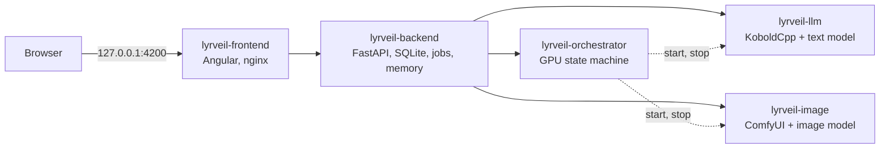

# Lyrveil

**A private messaging app where the contacts are AI characters you create. It runs entirely on your own computer.**

> **Project status (2026-11-09): in development, not released.** The application code exists: the backend, the GPU orchestrator, the Angular interface, the Docker images and the Windows scripts. Phases P01 to P07 of the [roadmap](docs/roadmap.md) are built and passed their automated tests with fake text and image runtimes. **No real model has run yet**: the hardware checks of phases P02 to P06 (a real reply, a real image, the GPU hand-over) and the quality measurements are pending, so the speed, memory and quality claims below are targets, not results. `start.cmd` does not yet start the orchestrator, so a conversation on a real installation does not yet get a model reply (see [Starting](#starting)). The release audit (P09) has not run.

**In italiano.** Lyrveil è un'applicazione di messaggistica simulata e completamente locale. Crei personaggi con una propria identità, memoria e stile, chatti con loro in italiano e ricevi anche immagini generate. Nessun dato lascia il tuo computer. Il progetto è in sviluppo e non è ancora stato rilasciato: nessun modello reale è stato ancora provato.

## Screenshots

There are none in the repository yet. A script generates them from the demo characters and synthetic data ([Demo screenshots](docs/screenshots.md)), but it has not run, and the images are added to this page in phase P09 after a visual review. Until then, the [design system](docs/design-system.md#layout) has layout sketches.

## Features

These describe version 1.0. Each is built and tested against fake runtimes, except where [Limitations](#limitations) says otherwise; none has been seen with a real model.

- **A familiar messenger.** Contacts, unread counts, typing indicators, streaming replies, day separators, images in chat, alternatives, editing and search.
- **Characters with depth.** Identity, personality, communication style and visual profile, described in words rather than sliders. Example lines show how each character writes, and a wardrobe holds their outfits. Create them by hand, or from a natural-language description. Versioned, importable and exportable.
- **Persistent memory.** Characters remember facts, events and how your relationship has changed, across restarts and very long conversations, without any extra model.
- **Consistency with any verified model.** Characters keep their name, age, grammatical gender, `tu` or `lei`, reply length and style whichever catalog text model you choose. A short reminder before each reply and the same reply rules for every model keep them steady, and each catalog model must pass the same scripted conversations. Characters do not know what you said in another chat.
- **Memory you can see and correct.** The Memory Studio shows what a character remembers, where it came from and how sure it is.
- **Images as messages.** Ask in Italian and get an image in the chat. Images stay available when the image runtime is off.
- **Automatic GPU handling.** The text and image models take turns on a single 12 GB card. Messages sent meanwhile are saved and answered afterwards.
- **Optional proactive messages.** Off by default, with quiet hours and limits. The scheduler is built, but no screen switches it on yet.
- **Italian first.** Interface, characters and memories default to Italian. Each character or chat can use another language.
- **Offline and private.** No account, no cloud, no telemetry.

## Architecture



Three services are always on. The two AI runtimes never run together. Details are in the [architecture document](docs/architecture.md).

## Hardware requirements

| Item | Target | Reduced tier |
| --- | --- | --- |
| Operating system | Windows 11 with WSL2 | Same |
| GPU | NVIDIA RTX 4070, 12 GB | Same |
| RAM | 32 GB, with [`.wslconfig`](docs/operations.md#wsl2-memory) | 16 GB, with `.wslconfig` and swap |
| Disk | 50 GB free for setup | 40 GB |
| Software | Docker Desktop with WSL2 backend, Git for Windows | Same |

See the [full requirements](docs/operations.md#requirements).

## Installation

Everything runs from Windows, in PowerShell or with a double click. Docker Desktop runs the containers
in its own virtual machine, which you never open. The steps below were run against test projects with fake runtimes,
not yet against the real models and GPU.

```powershell
git clone https://github.com/AjimuZ/Lyrveil.git $env:USERPROFILE\Desktop\projects\lyrveil
```

```powershell
cd $env:USERPROFILE\Desktop\projects\lyrveil
```

```powershell
.\setup.cmd
```

`setup.cmd` checks the system, creates the data and models volumes and `.env`, builds the images and creates the runtime
containers without starting them. It does not download models yet. Run `scripts\lyrveil.cmd models` afterwards: it shows
the model licenses for your acceptance, downloads the default text and image models of your hardware tier with
verification, and `scripts\lyrveil.cmd models -List` shows what is present.
Conversations and models are kept in Docker volumes for speed, and a daily backup is copied to
`Documents\Lyrveil\backups`.

## Configuration

Settings live in `.env`, in the launch files and in the application's settings screens. The defaults need no changes. See [Configuration](docs/configuration.md).

## Starting

```powershell
.\start.cmd
```

Then open `http://localhost:4200`. The other commands are `.\stop.cmd`, `.\restart.cmd`, `.\status.cmd` and `.\logs.cmd`.

As of 2026-11-09, `start.cmd` starts the backend and the frontend only. It does not start the orchestrator, which
controls the text and image runtimes, so the app opens for reading and editing, but a message gets no reply from a real
model. The tests start a fake orchestrator themselves. See [Operations](docs/operations.md#startcmd).

## Supported models

You choose the active text and image models in **Impostazioni > Modelli**, from a catalog of verified profiles. One of
each is active at a time. Files are downloaded on your machine from their upstream repositories, pinned by revision and
hash, and they are never included in this repository or in a Docker image. The full catalog, with licenses and memory
estimates, is in the [model catalog](docs/models.md).

| Use | Default | Size | Other profiles | Runtime |
| --- | --- | --- | --- | --- |
| Text, 32 GB | [Gemma 4 26B-A4B](https://huggingface.co/google/gemma-4-26B-A4B-it-qat-q4_0-gguf), Q4_0 | 14.44 GB | Gemma 4 12B, Orion 26B-A4B, Rocinante-X 12B, Rocinante 12B v1.1 | [KoboldCpp](https://github.com/LostRuins/koboldcpp) |
| Text, 16 GB | [Gemma 4 12B](https://huggingface.co/google/gemma-4-12B-it-qat-q4_0-gguf), Q4_0 | 6.98 GB | Rocinante-X 12B, Rocinante 12B v1.1 | KoboldCpp |
| Images | [Illustrious XL v2.0](https://huggingface.co/OnomaAIResearch/Illustrious-XL-v2.0) | 6.94 GB | Illustrious XL v1.0, NoobAI-XL 1.1 | [ComfyUI](https://github.com/Comfy-Org/ComfyUI) |

Images render in two passes by default (**Alta**): a first pass near one megapixel, then a refinement pass at 1.5 times
the size, up to 1248 x 1824. **Rapida** renders one pass in about a third of the time.

## How memory works

Every message stays in the database. Every 8 to 12 messages, or at significant events, the loaded text model proposes structured memories. Code validates them, and keeps facts apart from inferences, fiction and temporary information. When a fact changes, the old version stays in the history and the new one is used.

Before each reply, SQLite FTS5 finds the relevant memories, and a builder composes the prompt within the token budget. A long conversation also gets progressive summaries. Read the [memory engine](docs/memory-engine.md).

## How images work

You ask for an image, in Italian if you like. The text model describes the scene in a fixed structure: framing, expression, pose, place, lighting and outfit. Code adds the character's fixed look and builds the English prompt from an original tag vocabulary, so the character looks the same whichever text model is active. The character also writes the message that comes with the image, in its own voice. Then the text model stops, the image runtime starts and renders, the file is stored and appears in the chat, and the text model returns. Anything you write meanwhile is saved and answered afterwards. Read [image generation](docs/image-generation.md) and [GPU orchestration](docs/gpu-orchestration.md).

## Limitations

These are expected in version 1.0:

- One user on one machine. No LAN or remote access.
- NVIDIA GPUs on Windows with WSL2 are the only tested target.
- Switching between text and image models is expected to take up to a couple of minutes.
- Other programs using the GPU can delay or block loading a model. Lyrveil tells you, and never closes them.
- Keeping a character's look consistent across images is best-effort. The same structured identity is used every time, but without reference images the model can still vary the face and small details.
- No model card names Italian among its supported languages. Quality is measured, and known limits will be recorded here.
- Custom text models can be used, but only catalog profiles are checked for consistency.
- The 26B text profiles keep part of their weights in system RAM. They need 32 GB and start a new long conversation more slowly than the 12B profiles.
- Characters must be adults, and the safeguards are best-effort filters.
- Data is not encrypted by Lyrveil. Use disk encryption.
- Conversations and models are stored in Docker volumes, not in visible folders. Resetting or uninstalling Docker Desktop deletes them. The daily backup copied to Windows limits the loss to one day.
- All characters are simulated by AI models. They can be wrong, and are not a source of advice.

## Troubleshooting

The [troubleshooting table](docs/operations.md#troubleshooting) covers GPU access, memory, line endings, ports, model verification and stuck states.

## Licenses

Lyrveil's original code and documentation are under the [Apache License 2.0](LICENSE). The runtimes and models have their own terms, and **you must review them before use**:

| Component | License |
| --- | --- |
| KoboldCpp | GNU AGPL v3.0 |
| ComfyUI | GNU GPL v3.0 |
| Gemma 4, default text models | Apache 2.0 |
| Illustrious XL v2.0 and v1.0 | CreativeML Open RAIL licenses, including use restrictions |
| NoobAI-XL 1.1, optional | Fair AI Public License 1.0-SD, including use restrictions |
| Orion, Rocinante-X and Rocinante, optional | No terms stated on their cards. Base models under Apache 2.0 |

Details and obligations are in [Licensing](docs/licensing.md).

## Contributing and security

See [CONTRIBUTING](CONTRIBUTING.md) and [SECURITY](SECURITY.md). All documentation is indexed in [docs/README.md](docs/README.md).

## Acknowledgements

Lyrveil builds on the work of these projects: [KoboldCpp](https://github.com/LostRuins/koboldcpp) and KoboldAI Lite, [llama.cpp](https://github.com/ggml-org/llama.cpp) and GGML, [ComfyUI](https://github.com/Comfy-Org/ComfyUI), [Gemma 4](https://huggingface.co/google/gemma-4-26B-A4B-it) by Google, Orion, Rocinante-X and [Rocinante](https://huggingface.co/TheDrummer/Rocinante-12B-v1.1) by TheDrummer, the GGUF quantizations by bartowski, [Mistral Nemo](https://huggingface.co/mistralai/Mistral-Nemo-Base-2407) by Mistral AI, [Illustrious XL](https://huggingface.co/OnomaAIResearch/Illustrious-XL-v2.0) by OnomaAI Research, [NoobAI-XL](https://huggingface.co/Laxhar/noobai-XL-1.1) by Laxhar Dream Lab, Stable Diffusion XL by Stability AI, and the Inter, Pixelify Sans and JetBrains Mono typefaces.
