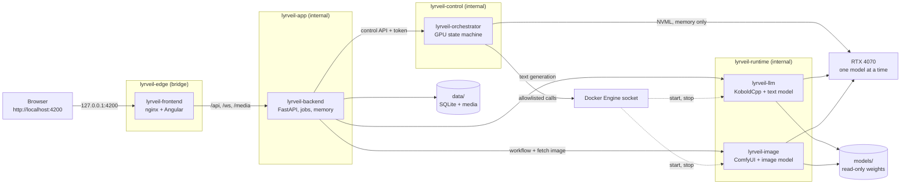
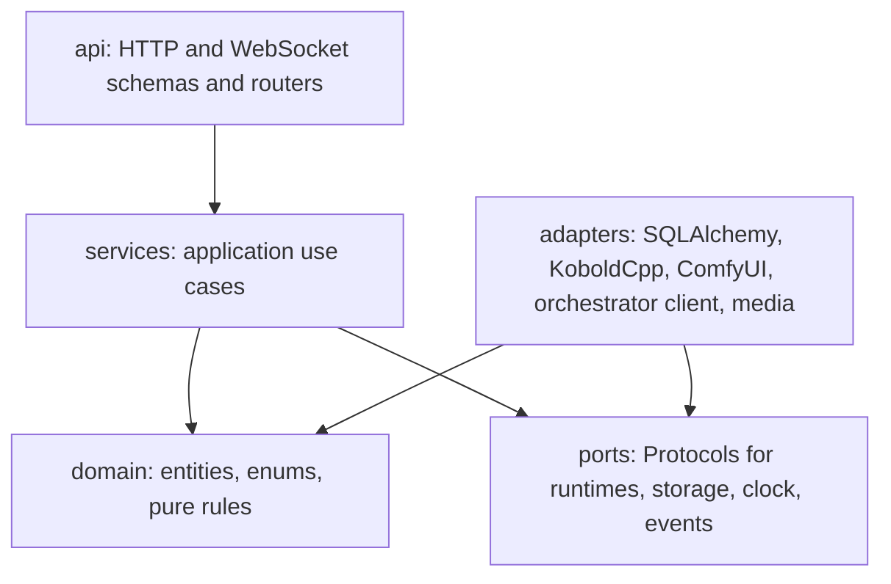
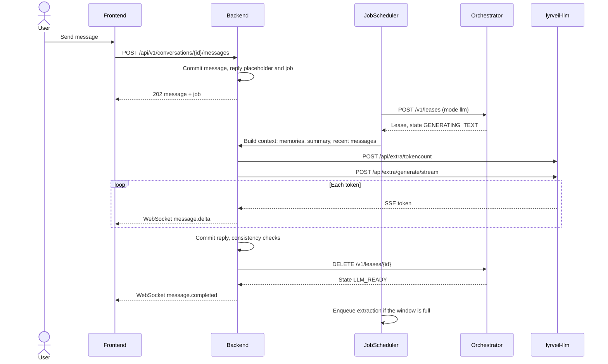

# Architecture

Status: accepted (2026-11-01). Implementation: planned, phases P01 to P07.

Lyrveil has five Docker services. Three are always on and hold no model. Two are AI
runtimes that take turns on the GPU. SQLite and the media files on the WSL2 Linux
filesystem are the only durable state.

## Components



| Service | Runs | Responsibility | Network | Published port | State |
| --- | --- | --- | --- | --- | --- |
| `lyrveil-frontend` | Always | Serves the built Angular app. Proxies `/api`, `/ws`, `/media`. Sets security headers. | edge, app | `127.0.0.1:4200` | None |
| `lyrveil-backend` | Always | Domain services, REST and WebSocket APIs, job queue and scheduler, memory and consistency engines, media store. Sole SQLite writer. | app, control, runtime | None | `data/` |
| `lyrveil-orchestrator` | Always | Model Lifecycle Manager: GPU state machine, leases, container control, NVML monitoring, recovery. | control | None | Memory only |
| `lyrveil-llm` | On demand | KoboldCpp with the active [text profile](models.md#text-profiles). Text generation and tokenizer. | runtime | None | None |
| `lyrveil-image` | On demand | ComfyUI with the active [image profile](models.md#image-profiles). Runs one workflow at a time. | runtime | None | Temporary files in tmpfs |

Only `lyrveil-edge` can reach the outside. The backend and both runtimes sit on
internal networks with no route to the Internet. This enforces offline operation
and keeps private text inside the machine
([ADR 0003](decisions/0003-service-topology-and-networks.md)).

## Invariants

These always hold. Tests check each one ([Testing](testing.md)).

1. **Exclusive GPU.** At most one of `lyrveil-llm` and `lyrveil-image` runs at any time.
2. **Single control point.** Only the orchestrator starts or stops the runtimes, and
   only those two containers.
3. **Lease before work.** The backend calls a runtime only while holding a valid
   lease for that runtime's mode.
4. **Single writer.** Only the backend process opens SQLite. It runs one process with
   one job worker.
5. **Save first.** A user message is committed before any job is created for it.
6. **Runtime independence.** Showing history and images never needs a runtime. Files
   are copied to `data/media` before a message refers to them.
7. **Canonical protection.** Only an explicit user operation changes the canonical
   character definition.
8. **Conversation isolation.** Every memory query takes a mandatory scope. No
   repository method reads across conversations, except for the configured shared
   memory of the same character.
9. **Local only.** No component calls a host outside the Docker networks at runtime.
10. **No private text in logs.** Logs carry identifiers, sizes and codes, never message
    content, prompts or memory text.

## Layers



- `domain` imports nothing from the project except itself and performs no I/O.
- `services` depend on `domain` and on ports, never on an adapter.
- `api` only validates, calls a service and maps the result. It holds no business rule.
- `main.py` is the composition root. It alone wires adapters to ports.

Details are in [Backend](backend.md).

## Main flows

### Send a text message



### Request an image

The backend prepares the prompt with the text model, hands over the GPU, generates,
stores the file and gives the GPU back. See
[GPU orchestration](gpu-orchestration.md#the-18-steps-of-an-image-request).

### Restart

1. The orchestrator starts in `RECOVERING`, inspects both containers and reconciles
   its state with what is really running.
2. The backend applies pending migrations and verifies FTS5 and WAL.
3. The backend requeues jobs left `running`, marks partial replies `interrupted` and
   fetches lifecycle events it missed.
4. The queue resumes. Scheduled events that were missed follow their policy. Nothing
   is generated retroactively ([Scheduler](scheduler.md#missed-events)).

## Failure domains

| Failure | Effect | Recovery |
| --- | --- | --- |
| `lyrveil-llm` crashes during a reply | Partial text is kept, marked `interrupted` | Orchestrator enters `RECOVERING` and reloads. Job retries once. |
| `lyrveil-image` runs out of memory | Image job pauses | One retry with tiled VAE decode, then a failed image message with a retry action. Text model returns either way. |
| Orchestrator restarts | Lease is lost, running job fails with `LEASE_LOST` | Reconcile, job retries without losing attempts. |
| Backend restarts | WebSocket clients reconnect, leases expire | Orchestrator returns to ready after lease expiry. Jobs requeue. |
| Another program takes the VRAM | Model cannot load | State stays `IDLE` with a clear reason, retries for a limited time. No external process is touched. |
| Docker Desktop stops | All services stop | `./start.sh` restores everything. SQLite commits are durable. |
| Power loss | Current generation is lost | SQLite in WAL with `synchronous=FULL` keeps every committed message. Staged media is cleaned at startup. |

## Repository layout

Directories marked "planned" do not exist yet.

```text
lyrveil/
  frontend/              Angular application (planned, P01)
  backend/               FastAPI application and migrations (planned, P01)
  orchestrator/          Model Lifecycle Manager (planned, P01)
  docker/
    llm/                 KoboldCpp image: Dockerfile, entrypoint (planned, P02)
    image/               ComfyUI image: Dockerfile, lock file (planned, P05)
  workflows/comfyui/     API-format ComfyUI workflows (planned, P05)
  config/examples/       Example configuration (planned, P01)
  scripts/               Implementations and helpers (planned, P01)
  tests/                 End-to-end, GPU, quality tests and fakes (planned, P01)
  docs/                  This documentation
  models/.gitkeep        Weights, never committed (planned, P01)
  data/.gitkeep          User data, never committed (planned, P01)
  setup.sh start.sh stop.sh restart.sh status.sh logs.sh   Entry points (planned, P01)
  compose.yaml           Service definitions (planned, P01)
  .env.example           Configuration template (planned, P01)
  README.md LICENSE NOTICE CHANGELOG.md CONTRIBUTING.md SECURITY.md
  .gitignore .dockerignore .gitattributes
```

[ADR 0022](decisions/0022-root-scripts-and-repository-layout.md) explains the layout.

## Extension points

| Future need | Seam | Change required |
| --- | --- | --- |
| Another text or image model | `TextRuntime`, `ImageRuntime`, model settings | New adapter or new model file, plus a user decision |
| Semantic or hybrid memory search | `MemoryRetriever` | New implementation, no caller changes |
| LoRA and reference images | `loras_json`, `reference_asset_ids_json`, workflow templates | New workflow template |
| PostgreSQL or a separate queue | Repositories and `PersistenceService` | New adapters and an ADR |
| More interface languages | Translation catalogs | New catalog |
