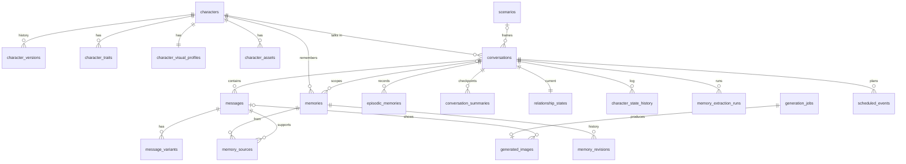

# Data model

Status: accepted (2026-11-01), revised 2026-11-05 for model profiles. Implementation: partial. Delivered: `application_settings` (P01), `generation_jobs` (P02.4), `conversations` with `characters` (P02.5a, revision `0003`), and `messages` with `message_variants` (P02.5b, revision `0004`). The rest is planned, phases P02 to P07.

SQLite is the single database, at `data/db/lyrveil.sqlite3`. Only the backend opens it
([ADR 0004](decisions/0004-single-sqlite-writer.md)).

## Conventions

| Topic | Rule |
| --- | --- |
| Primary keys | `TEXT`, UUIDv7 from an internal helper, so identifiers sort by creation time. |
| Timestamps | UTC, ISO-8601 text with milliseconds, through a `UtcDateTime` type. Local time is computed only at display and prompt time. |
| Booleans | `BOOLEAN` with `CHECK (col IN (0, 1))`. |
| JSON columns | `TEXT` with `CHECK (json_valid(col))`, suffix `_json`, validated by a Pydantic model at the boundary. |
| Enumerations | `TEXT` with a `CHECK` list. |
| File paths | Relative to `data/`. Absolute paths never enter the database. |
| Tables | Not `STRICT`, because SQLAlchemy's `BOOLEAN` and `DATETIME` names are rejected in strict tables. `CHECK` constraints cover the need. |

### Connection settings

Set on every connection and verified at startup:

```sql
PRAGMA journal_mode = WAL;
PRAGMA synchronous = FULL;       -- a committed message survives power loss
PRAGMA foreign_keys = ON;
PRAGMA busy_timeout = 5000;
PRAGMA wal_autocheckpoint = 1000;
```

At startup the backend also verifies that `journal_mode` really returned `wal` and that
`PRAGMA compile_options` lists `ENABLE_FTS5`. A failure stops the service with
`DB_CAPABILITY_MISSING`. Delivered in P01.3b: the check also creates a temporary `fts5` table, and the Alembic baseline
holds only `application_settings`. The other tables of this document are planned, each in the revision of its phase.

## Relationships



## Character tables

### `characters`

The current canonical definition. Only `CharacterService` writes it.

| Column | Type | Rules |
| --- | --- | --- |
| `id` | TEXT | PK |
| `first_name` | TEXT | NOT NULL, 1 to 80 chars |
| `last_name` | TEXT | NULL |
| `age` | INTEGER | NOT NULL, `CHECK (age >= 18)` |
| `grammatical_gender` | TEXT | NOT NULL, default `non_indicato`, `CHECK (grammatical_gender IN ('femminile', 'maschile', 'non_indicato'))` |
| `narrative_identity`, `biography`, `background`, `setting` | TEXT | NOT NULL, default empty |
| `occupation` | TEXT | NOT NULL, default empty |
| `interests_json` | TEXT | List of strings |
| `primary_language` | TEXT | NOT NULL, default `it` |
| `communication_json` | TEXT | `CommunicationProfile`, see [Character system](character-system.md#card-schema) |
| `current_version_no` | INTEGER | NOT NULL |
| `status` | TEXT | `active`, `archived` |
| `is_demo` | BOOLEAN | Original demo character |
| `archived_at`, `created_at`, `updated_at` | TEXT | Timestamps |

Index: `(status, updated_at DESC)`.

### `character_versions`

Append-only snapshots of the full card. Restoring creates a new version.

| Column | Type | Rules |
| --- | --- | --- |
| `id` | TEXT | PK |
| `character_id` | TEXT | FK `characters`, RESTRICT |
| `version_no` | INTEGER | NOT NULL, unique with `character_id` |
| `snapshot_json` | TEXT | Identity, traits, communication and visual profile |
| `change_summary` | TEXT | NOT NULL |
| `actor` | TEXT | `user`, `import`, `restore`, `duplicate`, `proposal` |
| `created_at` | TEXT | |

### `character_traits`

Descriptive personality entries. Text is primary. There is no score column.

| Column | Type | Rules |
| --- | --- | --- |
| `id` | TEXT | PK |
| `character_id` | TEXT | FK, RESTRICT |
| `category` | TEXT | `main_trait`, `value`, `motivation`, `preference`, `flaw`, `fear`, `habit`, `humor`, `temperament`, `relational_style` |
| `description` | TEXT | NOT NULL, up to 500 chars |
| `sort_order` | INTEGER | NOT NULL |
| `locked` | BOOLEAN | Excluded from AI drafts and proposals |
| `created_at`, `updated_at` | TEXT | |

Index: `(character_id, category, sort_order)`.

### `character_visual_profiles`

| Column | Type | Rules |
| --- | --- | --- |
| `character_id` | TEXT | PK, FK, RESTRICT |
| `face`, `hair`, `eyes`, `body`, `clothing`, `accessories`, `distinctive_marks`, `art_style` | TEXT | Italian descriptions |
| `subject_tag` | TEXT | `1girl`, `1boy`, `1other` |
| `identity_en_json` | TEXT | `VisualIdentityEn`: the structured English identity used in every image ([ADR 0035](decisions/0035-structured-visual-identity-and-wardrobe.md)) |
| `usual_outfit_en_json` | TEXT | English tags of the usual outfit, up to 12 |
| `outfits_json` | TEXT | Up to 5 named outfits: key, Italian label and description, English tags |
| `persistent_negative_en` | TEXT | Extra negative tags |
| `prompt_source_hash` | TEXT | Hash of the description fields. A difference triggers a new translation job. |
| `locked_fields_json` | TEXT | Field names excluded from automatic rewriting |
| `seed_policy` | TEXT | `random`, `fixed`, `base_offset` |
| `base_seed` | INTEGER | NULL unless a policy needs it |
| `primary_avatar_asset_id` | TEXT | FK `character_assets`, SET NULL |
| `loras_json` | TEXT | Prepared. Always `[]` in 1.0 |
| `reference_asset_ids_json` | TEXT | Stored, not used by 1.0 workflows |
| `updated_at` | TEXT | |

### `character_assets`

| Column | Type | Rules |
| --- | --- | --- |
| `id` | TEXT | PK |
| `character_id` | TEXT | FK, RESTRICT |
| `kind` | TEXT | `avatar`, `profile`, `scene`, `variant`, `reference` |
| `source` | TEXT | `upload`, `generated` |
| `generated_image_id` | TEXT | FK `generated_images`, SET NULL |
| `file_path`, `media_type` | TEXT | NOT NULL |
| `width`, `height`, `byte_size` | INTEGER | NOT NULL |
| `sha256` | TEXT | NOT NULL |
| `crop_json` | TEXT | Crop rectangle applied, or NULL |
| `is_primary` | BOOLEAN | One per character among avatars |
| `created_at`, `deleted_at` | TEXT | |

Partial unique index: `(character_id) WHERE is_primary = 1 AND kind = 'avatar' AND deleted_at IS NULL`.

## Conversation tables

### `scenarios`

| Column | Type | Rules |
| --- | --- | --- |
| `id` | TEXT | PK |
| `title` | TEXT | NOT NULL |
| `description`, `setting`, `opening_message` | TEXT | NOT NULL, default empty |
| `character_id` | TEXT | FK, SET NULL. NULL means usable with any character |
| `language` | TEXT | NULL inherits |
| `status` | TEXT | `active`, `archived` |
| `created_at`, `updated_at` | TEXT | |

### `conversations`

| Column | Type | Rules |
| --- | --- | --- |
| `id` | TEXT | PK |
| `character_id` | TEXT | FK, RESTRICT |
| `scenario_id` | TEXT | FK, SET NULL |
| `scenario_snapshot_json` | TEXT | Copy at creation. Later scenario edits never change a running story. |
| `title` | TEXT | Default: the character's name |
| `language` | TEXT | NULL inherits `characters.primary_language` |
| `status` | TEXT | `active`, `archived`, `deleted` |
| `pinned_at` | TEXT | NULL when not pinned |
| `shares_memory` | BOOLEAN | Default 0. Reads shared memory only when 1. Nothing is written to the shared scope automatically |
| `next_seq` | INTEGER | NOT NULL, next message number |
| `last_message_at` | TEXT | |
| `last_read_seq` | INTEGER | Unread count basis |
| `last_extracted_seq`, `last_summarized_seq` | INTEGER | Pipeline cursors |
| `proactive_json` | TEXT | Settings, see [Scheduler](scheduler.md#per-conversation-settings) |
| `created_at`, `updated_at`, `deleted_at` | TEXT | |

Indexes: `(status, pinned_at, last_message_at DESC)`, `(character_id, status)`.

Delivered in revision `0003` (P02.5a) with `CHECK` lists, `json_valid` on the JSON columns and the two indexes.
`scenario_id` is a plain column until `scenarios` exists. `characters` has all its columns but none of its child
tables yet (P03.1a). The list orders pinned chats first (newest pin first), then by `last_message_at`, or
`created_at` while a chat has no message. Restoring a deleted conversation sets `active`, because the status before
the delete is not stored; cancelling its scheduled events joins the delete with `scheduled_events` (P07).

### `messages`

| Column | Type | Rules |
| --- | --- | --- |
| `id` | TEXT | PK |
| `conversation_id` | TEXT | FK, RESTRICT |
| `seq` | INTEGER | NOT NULL, unique with `conversation_id` |
| `client_message_id` | TEXT | NULL, unique with `conversation_id`. Makes sending idempotent. |
| `author` | TEXT | `user`, `character`, `system` |
| `kind` | TEXT | `text`, `image`, `mixed`, `notice` |
| `status` | TEXT | `queued`, `streaming`, `complete`, `failed`, `interrupted` |
| `read_state` | TEXT | `sent`, `read`. Simulated, user messages only |
| `active_variant_id` | TEXT | FK `message_variants`, SET NULL |
| `content` | TEXT | Copy of the active variant's text, for the list and FTS |
| `token_count` | INTEGER | NULL until counted |
| `tokenizer_id` | TEXT | Text profile whose tokenizer produced `token_count`. A different active profile makes the count stale |
| `scheduled_event_id` | TEXT | FK, SET NULL. Set on proactive messages |
| `edited_at`, `deleted_at`, `created_at` | TEXT | |

Index: `(conversation_id, seq)`, partial `(conversation_id, seq) WHERE deleted_at IS NULL`.

Delivered in revision `0004` (P02.5b) with `CHECK` lists, the unique `(conversation_id, seq)` that also serves as the
first index, and a partial unique index on `(conversation_id, client_message_id)` for non-null values.
`scheduled_event_id` is a plain column until `scheduled_events` exists. `active_variant_id` has no key, because the
variant table points back at the message; the service keeps it valid. `read_state` is NULL for messages that are not
the user's. `seq` is taken from `conversations.next_seq` in the same write transaction as the insert and is never
reused, so a deleted message leaves a gap. A send writes a user message and a reply placeholder with consecutive
numbers: the user's is `complete`; the character's is `queued`, with empty `content` and one `streaming` variant that
its `chat_reply` job fills (`payload` holds `variant_id`). The job's `idempotency_key` is `chat_reply:<user message id>`
and its `message_id` the reply's. Deleting only sets `deleted_at`; the message and its variants stay.

### `message_variants`

Every text or image version of a message. A user edit and a regeneration each add one.

| Column | Type | Rules |
| --- | --- | --- |
| `id` | TEXT | PK |
| `message_id` | TEXT | FK, RESTRICT |
| `variant_no` | INTEGER | NOT NULL, unique with `message_id` |
| `content` | TEXT | NOT NULL, default empty |
| `content_hash` | TEXT | NOT NULL. Basis for idempotency and invalidation |
| `image_id` | TEXT | FK `generated_images`, SET NULL |
| `source` | TEXT | `user`, `generated`, `edited` |
| `status` | TEXT | `streaming`, `complete`, `failed`, `interrupted` |
| `generation_params_json` | TEXT | Text profile, file SHA-256, template family, sampler values and length band. NULL for user text |
| `checks_json` | TEXT | Normalizer rules and reply checks that fired, with counts, and the number of corrective generations. NULL for user text |
| `prompt_assembly_id` | TEXT | FK, SET NULL |
| `created_at` | TEXT | |

Delivered in revision `0004` (P02.5b) with `CHECK` lists and `json_valid` on the two JSON columns. `image_id` and
`prompt_assembly_id` are plain columns until their tables exist. A regeneration inserts a `generated` variant with
status `streaming` and empty text, makes it the message's active variant and queues `chat_regenerate` with its id under
the key `chat_regenerate:<variant id>`; the older variants stay selectable. An edit inserts an `edited` variant that is
already `complete`. The keys from `generation_jobs` to `conversations`, `characters` and `messages` are still plain
columns: the batch rebuild of the job table is not part of this revision.

Since P02.5c the reply job writes the variant its payload names, never a new one
([Streaming persistence](backend.md#streaming-persistence)). A run sets the message `streaming` with empty text, then
writes the text to the variant and the message every 2 seconds and at the end, with `content_hash` recomputed each
time. A finished run sets both `complete` (`interrupted` when the runtime reports the generation aborted). A failure
that will be retried puts the message back to `queued` with empty text and leaves the variant `streaming`; a final
failure sets both `failed` and keeps the text streamed so far. At startup every message still `streaming` becomes
`interrupted` with its active variant, and keeps its text. `generation_params_json` and `checks_json` stay NULL until
the settings store and the reply checks exist (P04).

## Memory tables

See [Memory engine](memory-engine.md) for behavior.

### `memories`

Layers B (shared) and C (conversation).

| Column | Type | Rules |
| --- | --- | --- |
| `id` | TEXT | PK |
| `character_id` | TEXT | FK, RESTRICT |
| `scope` | TEXT | `conversation`, `shared` |
| `conversation_id` | TEXT | FK, RESTRICT. `CHECK ((scope = 'conversation') = (conversation_id IS NOT NULL))` |
| `origin_conversation_id` | TEXT | FK, SET NULL. Provenance of shared memories |
| `kind` | TEXT | `user_fact`, `user_preference`, `character_fact`, `narrative_event`, `promise`, `decision`, `open_thread`, `boundary`, `identity_candidate` |
| `content` | TEXT | NOT NULL, up to 280 chars |
| `subject_key` | TEXT | Normalized, for example `user.employer`. NULL for free text |
| `value_text` | TEXT | Normalized value of the subject |
| `provenance` | TEXT | `stated`, `inferred`, `fictional`, `user_confirmed` |
| `durability` | TEXT | `lasting`, `temporary` |
| `status` | TEXT | `active`, `uncertain`, `superseded`, `contradicted`, `expired`, `invalidated` |
| `importance` | INTEGER | 1 to 5 |
| `confidence` | REAL | 0 to 1 |
| `locked` | BOOLEAN | Automation cannot change it |
| `needs_review` | BOOLEAN | A locked memory lost its source |
| `valid_from`, `valid_to`, `expires_at` | TEXT | Temporal validity |
| `superseded_by_id` | TEXT | FK `memories`, SET NULL |
| `conflict_group_id` | TEXT | Groups uncertain conflicting memories |
| `version` | INTEGER | NOT NULL, starts at 1 |
| `fingerprint` | TEXT | Hash of normalized content |
| `language` | TEXT | NOT NULL |
| `last_used_at` | TEXT | Last time it entered a prompt |
| `use_count` | INTEGER | NOT NULL, default 0 |
| `created_at`, `updated_at` | TEXT | |

Indexes:

- `(character_id, scope, conversation_id, status)`
- `(character_id, conversation_id, subject_key) WHERE subject_key IS NOT NULL`
- Unique: `(character_id, ifnull(conversation_id, 'shared'), fingerprint) WHERE status IN ('active', 'uncertain')`

### `memory_revisions`

Append-only. One row per earlier version.

| Column | Type | Rules |
| --- | --- | --- |
| `id` | TEXT | PK |
| `memory_id` | TEXT | FK, CASCADE (a purge of the parent only) |
| `version` | INTEGER | Unique with `memory_id` |
| `snapshot_json` | TEXT | Full row before the change |
| `actor` | TEXT | `extraction`, `user`, `consistency` |
| `reason` | TEXT | NOT NULL |
| `run_id` | TEXT | FK `memory_extraction_runs`, SET NULL |
| `created_at` | TEXT | |

### `memory_sources`

| Column | Type | Rules |
| --- | --- | --- |
| `memory_id` | TEXT | PK part, FK, CASCADE (purge only) |
| `message_id` | TEXT | PK part, FK, RESTRICT |
| `variant_id` | TEXT | PK part, FK, RESTRICT |
| `content_hash` | TEXT | Hash of the source text at extraction time |

Index: `(message_id)`, to find what a message edit affects.

### `memory_tombstones`

Blocks recreating a memory the user deleted.

| Column | Type | Rules |
| --- | --- | --- |
| `id` | TEXT | PK |
| `character_id` | TEXT | FK, RESTRICT |
| `conversation_id` | TEXT | FK, SET NULL |
| `fingerprint`, `subject_key`, `value_hash` | TEXT | Hashes and keys only. No original text is kept |
| `source_hashes_json` | TEXT | Hashes of the source messages |
| `source_max_seq` | INTEGER | Newest source message |
| `created_at` | TEXT | |

Index: `(character_id, conversation_id, fingerprint)`.

### `memory_extraction_runs`

Idempotency key and audit of each analysis.

| Column | Type | Rules |
| --- | --- | --- |
| `id` | TEXT | PK |
| `conversation_id` | TEXT | FK, RESTRICT |
| `from_seq`, `to_seq` | INTEGER | Window |
| `window_hash` | TEXT | Hash of the active variants in the window |
| `prompt_version`, `schema_version` | TEXT | |
| `status` | TEXT | `running`, `completed`, `failed`, `superseded` |
| `attempt` | INTEGER | |
| `raw_output` | TEXT | Local only, deleted after 30 days |
| `error_code` | TEXT | |
| `created_at`, `finished_at` | TEXT | |

Unique: `(conversation_id, window_hash, prompt_version, schema_version)`.

### `episodic_memories`

Layer D.

| Column | Type | Rules |
| --- | --- | --- |
| `id` | TEXT | PK |
| `character_id` | TEXT | FK, RESTRICT |
| `conversation_id` | TEXT | FK, RESTRICT |
| `title` | TEXT | NOT NULL, up to 120 chars |
| `description` | TEXT | NOT NULL, up to 600 chars |
| `occurred_at` | TEXT | NOT NULL |
| `participants_json` | TEXT | Names involved |
| `importance` | INTEGER | 1 to 5 |
| `status` | TEXT | `active`, `invalidated` |
| `locked` | BOOLEAN | |
| `fingerprint` | TEXT | Unique with `conversation_id` while active |
| `created_at`, `updated_at` | TEXT | |

Related tables:

- `episodic_sources`: `episode_id`, `message_id`, `variant_id`, `content_hash`.
- `episode_links`: `from_episode_id`, `to_episode_id`, `relation` (`causes`, `follows`, `related`).

### `conversation_summaries`

Versioned checkpoints.

| Column | Type | Rules |
| --- | --- | --- |
| `id` | TEXT | PK |
| `conversation_id` | TEXT | FK, RESTRICT |
| `level` | INTEGER | 0 for a message range, 1 and above for rollups |
| `from_seq`, `to_seq` | INTEGER | Range covered |
| `version` | INTEGER | Grows on re-summarization of the same range |
| `status` | TEXT | `active`, `superseded`, `invalidated` |
| `content_json` | TEXT | `events`, `decisions`, `relationship_changes`, `unresolved`, `key_facts`, `source_seqs` |
| `text` | TEXT | Compact prose used in the prompt |
| `source_hash` | TEXT | Hash of the covered variants |
| `prompt_version` | TEXT | |
| `token_count` | INTEGER | |
| `created_at` | TEXT | |

Unique: `(conversation_id, level, from_seq, to_seq, version)`. Partial index on `status = 'active'`.

### `relationship_states`

Layer E and the Character State Manager's current state. One row per conversation.

| Column | Type | Rules |
| --- | --- | --- |
| `conversation_id` | TEXT | PK, FK, RESTRICT |
| `familiarity`, `trust`, `confidence`, `tension` | INTEGER | 0 to 100. Internal support |
| `narrative` | TEXT | Description of the relationship. Primary |
| `expectations`, `boundaries` | TEXT | Stated by the user or established in the story |
| `emotional_state` | TEXT | Contextual, descriptive |
| `current_topic` | TEXT | |
| `open_threads_json`, `goals_json`, `recent_event_ids_json`, `narrative_changes_json` | TEXT | Lists |
| `last_history_id` | TEXT | FK, SET NULL |
| `updated_at` | TEXT | |

### `character_state_history`

Append-only log. The current state is a replay of its applied rows.

| Column | Type | Rules |
| --- | --- | --- |
| `id` | TEXT | PK |
| `conversation_id` | TEXT | FK, RESTRICT |
| `character_id` | TEXT | FK, RESTRICT |
| `event_kind` | TEXT | `relationship_change`, `emotion_change`, `thread_opened`, `thread_closed`, `goal_change`, `narrative_change`, `user_correction` |
| `dimension` | TEXT | `familiarity`, `trust`, `confidence`, `tension`, or NULL |
| `delta` | INTEGER | NULL for text-only events |
| `value_before`, `value_after` | TEXT | |
| `reason` | TEXT | NOT NULL |
| `source_message_ids_json` | TEXT | NOT NULL. Empty only for `user_correction` |
| `run_id` | TEXT | FK, SET NULL |
| `status` | TEXT | `applied`, `invalidated` |
| `created_at` | TEXT | |

Index: `(conversation_id, created_at)`.

### `prompt_assemblies`

Diagnostic record of a reply.

| Column | Type | Rules |
| --- | --- | --- |
| `id` | TEXT | PK |
| `conversation_id`, `message_id`, `variant_id` | TEXT | FKs, SET NULL except conversation |
| `blocks_json` | TEXT | Tokens per block, including the anchor, and the active corrective notes |
| `memory_refs_json` | TEXT | Memory IDs, scores and score parts |
| `summary_ids_json` | TEXT | Summaries used |
| `token_total`, `context_limit` | INTEGER | |
| `prompt_text` | TEXT | Stored only while diagnostic mode is on |
| `created_at` | TEXT | |

Retention: the newest 200 per conversation.

## Generation tables

### `generated_images`

| Column | Type | Rules |
| --- | --- | --- |
| `id` | TEXT | PK |
| `job_id` | TEXT | FK, SET NULL, unique. Makes persistence idempotent |
| `message_id`, `conversation_id` | TEXT | FKs, SET NULL. The image stays in the gallery |
| `character_id` | TEXT | FK, RESTRICT |
| `purpose` | TEXT | `chat`, `avatar`, `profile`, `scene`, `variant` |
| `file_path`, `thumb_path`, `media_type` | TEXT | |
| `width`, `height`, `byte_size` | INTEGER | |
| `sha256` | TEXT | Of the original file |
| `user_request` | TEXT | Original request text |
| `scene_json` | TEXT | The validated `ImageScene`, or the fallback scene |
| `aspect` | TEXT | `square`, `portrait`, `landscape`, `tall`, `wide`. The size actually used, after `auto` |
| `outfit_key` | TEXT | `usual`, a named outfit key, or `scene` |
| `prompt_positive`, `prompt_negative` | TEXT | Final prompts |
| `seed`, `steps` | INTEGER | |
| `cfg` | REAL | |
| `sampler`, `scheduler` | TEXT | |
| `clip_skip` | INTEGER | |
| `checkpoint_file`, `checkpoint_sha256`, `model_version` | TEXT | |
| `profile_id` | TEXT | Image profile used, for example `illustrious-xl-v2.0`, or `custom-<12 hex>` |
| `quality_preset` | TEXT | `alta` or `rapida`, the preset that produced the file after any fallback |
| `hires_denoise`, `hires_scale` | REAL | NULL for **Rapida** |
| `hires_steps` | INTEGER | NULL for **Rapida** |
| `workflow_id` | TEXT | Template name and version |
| `workflow_json` | TEXT | Exact submitted workflow |
| `comfyui_version` | TEXT | |
| `created_at`, `deleted_at` | TEXT | |

Indexes: `(character_id, created_at DESC)`, `(conversation_id, created_at DESC)`.

### `generation_jobs`

| Column | Type | Rules |
| --- | --- | --- |
| `id` | TEXT | PK |
| `kind` | TEXT | See [job kinds](gpu-orchestration.md#job-kinds-and-priorities) |
| `status` | TEXT | `queued`, `running`, `completed`, `failed`, `cancelled` |
| `stage` | TEXT | Kind-specific step |
| `required_mode` | TEXT | `llm`, `image`, `none` |
| `priority` | INTEGER | Lower runs first |
| `conversation_id`, `character_id`, `message_id` | TEXT | FKs, SET NULL |
| `payload_json`, `result_json` | TEXT | Versioned Pydantic models |
| `attempt`, `max_attempts` | INTEGER | |
| `not_before` | TEXT | Retry backoff |
| `lease_id`, `genkey` | TEXT | Current lease and abort key |
| `idempotency_key` | TEXT | Unique when not NULL |
| `error_code`, `error_detail` | TEXT | No private text in `error_detail` |
| `cancel_requested_at`, `created_at`, `started_at`, `finished_at` | TEXT | |

Index: `(status, required_mode, priority, created_at)`.

Delivered in revision `0002` (P02.4), with `CHECK` lists on `kind`, `status` and `required_mode`, `json_valid` on both
JSON columns, and a partial unique index on `idempotency_key`. The three foreign keys are plain columns until the
revision that creates `conversations`, `characters` and `messages` adds them. `stage` names the step that runs next,
and `attempt` counts the runs of that stage ([Job queue](backend.md#job-queue)).

### `model_lifecycle_events`

Written by the backend from the orchestrator's event stream.

| Column | Type | Rules |
| --- | --- | --- |
| `id` | TEXT | PK |
| `boot_id` | TEXT | Orchestrator process identity |
| `seq` | INTEGER | Unique with `boot_id` |
| `from_state`, `to_state` | TEXT | |
| `reason` | TEXT | Short code |
| `job_id` | TEXT | Plain text, no FK, so pruning stays independent |
| `vram_total_mib`, `vram_used_mib` | INTEGER | NULL when NVML is unavailable |
| `detail_json` | TEXT | |
| `occurred_at` | TEXT | |

Retention: the newest 50,000 rows.

### `image_proposals`

| Column | Type | Rules |
| --- | --- | --- |
| `id` | TEXT | PK |
| `conversation_id`, `message_id` | TEXT | FKs |
| `scene_json`, `reason` | TEXT | Validated output of the proposal step |
| `status` | TEXT | `pending`, `accepted`, `rejected`, `expired` |
| `job_id` | TEXT | FK, SET NULL |
| `created_at`, `decided_at` | TEXT | |

## Scheduling and settings

### `scheduled_events`

| Column | Type | Rules |
| --- | --- | --- |
| `id` | TEXT | PK |
| `conversation_id`, `character_id` | TEXT | FKs, RESTRICT |
| `kind` | TEXT | `scheduled_message`, `inactivity_check`, `follow_up`, `contextual_initiative` |
| `status` | TEXT | `pending`, `running`, `delivered`, `skipped`, `missed`, `cancelled`, `failed` |
| `due_at` | TEXT | NOT NULL |
| `recurrence_json` | TEXT | NULL, or a rule from [Scheduler](scheduler.md) |
| `note` | TEXT | The user's instruction, or the reason for a follow-up |
| `missed_policy` | TEXT | `skip`, `deliver_once`, `next_window` |
| `created_by` | TEXT | `user`, `scheduler` |
| `job_id`, `message_id` | TEXT | FKs, SET NULL |
| `outcome_reason` | TEXT | |
| `created_at`, `updated_at` | TEXT | |

Index: `(status, due_at)`.

### `notifications`

| Column | Type | Rules |
| --- | --- | --- |
| `id` | TEXT | PK |
| `kind` | TEXT | `proactive_message`, `image_ready`, `job_failed`, `memory_conflict`, `missed_events` |
| `conversation_id`, `message_id` | TEXT | FKs, SET NULL |
| `title`, `body` | TEXT | Italian by default |
| `read_at`, `created_at` | TEXT | |

### `application_settings`

| Column | Type | Rules |
| --- | --- | --- |
| `key` | TEXT | PK. Keys in [Configuration](configuration.md#application-settings) |
| `value_json` | TEXT | Validated against the settings model |
| `updated_at` | TEXT | |

## Full-text search

Each FTS table holds stemmed text ([Memory engine](memory-engine.md#stemming)), keeps its
own `content` and is updated by the same transaction as its source row. Application
code writes both, because stemming happens in Python and a SQL trigger cannot call it.

```sql
CREATE VIRTUAL TABLE memory_fts USING fts5(
  memory_id UNINDEXED,
  content_stem,
  subject_stem,
  tokenize = "unicode61 remove_diacritics 2"
);
CREATE VIRTUAL TABLE episode_fts USING fts5(
  episode_id UNINDEXED,
  title_stem,
  description_stem,
  tokenize = "unicode61 remove_diacritics 2"
);
CREATE VIRTUAL TABLE message_fts USING fts5(
  message_id UNINDEXED,
  conversation_id UNINDEXED,
  content_stem,
  tokenize = "unicode61 remove_diacritics 2"
);
```

A maintenance command rebuilds all three: `python -m lyrveil.cli rebuild-search`.

## Deletion policy

Ordinary deletion never removes rows from durable history. A foreign key is `RESTRICT`
unless this document says otherwise, so a programming error cannot cascade through
user data. `CASCADE` exists only on `memory_revisions` and `memory_sources`, which
have no meaning without their memory.

| User action | Effect | Reversible |
| --- | --- | --- |
| Delete a message | Sets `deleted_at`. Removes it from context and search. Derived data is re-evaluated. The image stays in the gallery. | Yes, until purge |
| Archive a conversation | `status = archived`. Hidden from the main list. | Yes |
| Delete a conversation | `status = deleted`, `deleted_at`. Hidden everywhere. Scheduled events are cancelled. | Yes, 30 days in **Impostazioni > Dati** |
| Purge a conversation | Hard delete after a preview of counts and typed confirmation. Options: keep images in the gallery (default) or delete them. | No |
| Archive a character | `status = archived`. Conversations hidden, nothing deleted. | Yes |
| Purge a character | Hard delete of all its conversations, memories, images and assets, after a preview of counts and typed confirmation. | No |
| Delete a memory | Removes the row, its revisions and sources. Adds a tombstone. | No, by design |
| Delete an image | Sets `deleted_at`, removes the files, keeps prompt metadata until purge. The message shows "immagine eliminata". | No |
| Delete an avatar or asset | Sets `deleted_at`, removes the file. Refused for the primary avatar until another is chosen. | No |

Purges run in `PersistenceService` as one transaction that deletes children in an
explicit order. Files are removed after the commit. A startup job removes orphan
files. Items in `deleted` status are purged automatically after 30 days.

## Migrations

- Alembic manages every schema change, including FTS tables as raw SQL.
- Migrations run at backend startup, after a pre-migration backup when any is pending.
- SQLite needs `render_as_batch=True` for table rebuilds.
- Downgrades are not supported. Restoring the pre-migration backup is the rollback.
- A test applies all migrations on an empty database and compares the result with the
  models.
