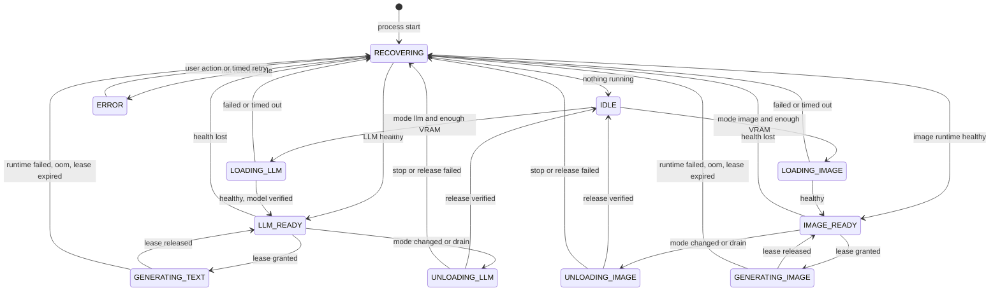

# GPU orchestration: Model Lifecycle Manager

Status: accepted (2026-11-01), revised 2026-11-05 for selectable model profiles. Implementation: partial. Delivered in P01.4a: the transition table in `orchestrator/src/lyrveil_orchestrator/state_machine.py`, tested by T-ORC-01. Delivered in P01.4b: `container_gate.py`, the allowlisted Docker calls that `ProcessSupervisor` will use, tested by T-ORC-07. Delivered in P01.4c: `gpu_monitor.py`, with `GPUResourceMonitor` reading NVML through the `GpuProbe` port. Delivered in P02.2, for text mode: `supervisor.py`, the `ProcessSupervisor`, with exclusivity rule 3, readiness and [release verification](#verifying-gpu-release); `lifecycle.py`, the `ModelLifecycleManager`, with the desired mode, the [leases](#leases-and-the-global-lock) (tested by T-ORC-03), drain, the event log and a reduced [recovery](#recovery). In P02.2, recovery keeps one healthy runtime, stops any other, and stops the image runtime when both run. A missing container or an unreachable Docker ends in `ERROR`, which only `POST /v1/recover` leaves. Load retries after 5 s and 20 s, and the third failure in a row ends in `ERROR`. Delivered in P05.7: the switch from `llm` to `image` and back for an image job, along the same states. The backend's `JobScheduler` asks for the mode with `PUT /v1/desired-mode`, and recovery verifies the release before `IDLE` (exclusivity rule 2): memory that does not settle ends in `ERROR` with `GPU_RELEASE_UNVERIFIED`. `orchestrator/tests/integration/test_image_lifecycle.py` tests the switch and rules 2 and 3 with `fake_docker` and `fake_nvml`. Delivered in P06.1: the [18 steps](#the-18-steps-of-an-image-request) played through the control API one step at a time (T-IMG-04), with the job that asked for a mode named on the events of its switch; the [property test](#exclusivity-rules) over random event sequences (T-ORC-02); and the backend's `gpu.state` event with the key of each state's [interface label](#interface-labels). Delivered in P06.2: the VRAM check before a load, the hold in `IDLE` with `blocked_reason`, the end of the waiting job after `vram.wait_seconds`, and the expected drop of a release in the event log ([Verifying GPU release](#verifying-gpu-release), T-ORC-04, T-ORC-05). Delivered in P06.3, in the backend's `JobScheduler`: the [selection rules](#selection) with batches, the image wait limit and the cap on images in a row, [preemption](#preemption) of background work, [cancellation](#cancellation) and the queue note of a reply that waits for an image (T-ORC-12, T-ORC-13, T-IMG-10, [ADR 0039](decisions/0039-scheduling-clocks-batches-and-stops.md)). Delivered in P06.4: the whole [recovery table](#recovery) with the timed retry out of `ERROR` (T-ORC-06), the classification of a failed text load from its exit status and logs, the [launch levels](#load-failures-and-launch-levels) the backend lowers after an out of memory (T-ORC-08), the runtime restart after an `oom` release, the return to text after three failed image loads, and the tiled and **Rapida** tries of an image out of memory (T-IMG-11, [ADR 0040](decisions/0040-load-failures-launch-levels-and-timed-recovery.md)). Still planned: the drain limit of a long foreground reply, the preferred-VRAM warning and the active profile's own requirement, the settings screen that shows the launch level and returns to A (P06.6), and `MODEL_FILE_MISSING` before a mode change.

The text model and the image model never share the GPU, whichever [profiles](models.md) are active. The orchestrator owns the GPU state and the two runtime containers. The backend owns the durable
job queue and asks the orchestrator for a mode and a lease
([ADR 0004](decisions/0004-single-sqlite-writer.md), [ADR 0005](decisions/0005-exclusive-gpu-by-container-lifecycle.md)).

## Normal state

| Component | State |
| --- | --- |
| `lyrveil-frontend`, `lyrveil-backend`, `lyrveil-orchestrator` | Running |
| `lyrveil-llm` | Running, the active text profile loaded, state `LLM_READY` |
| `lyrveil-image` | Created, stopped, no GPU allocation |

When the queue is empty, the desired mode is always `llm`.

## State machine



`state_machine.py` holds this table as data. It is pure and has no I/O. Any other transition, including one from a state to itself, raises `IllegalTransition` and is rejected; the caller, `ModelLifecycleManager`, logs it. The module also maps each state to the runtime it allows on the GPU, from the Containers column below: `IDLE`, `RECOVERING` and `ERROR` allow none.

| State | Meaning | Containers |
| --- | --- | --- |
| `IDLE` | No model in the GPU, verified | Both stopped |
| `LOADING_LLM` | KoboldCpp starting | LLM starting |
| `LLM_READY` | Text model loaded, no lease | LLM healthy |
| `GENERATING_TEXT` | A text lease is active | LLM healthy |
| `UNLOADING_LLM` | Stopping and verifying release | LLM stopping |
| `LOADING_IMAGE` | ComfyUI starting | Image starting |
| `IMAGE_READY` | ComfyUI ready, no lease | Image healthy |
| `GENERATING_IMAGE` | An image lease is active. The checkpoint loads here on first use | Image healthy |
| `UNLOADING_IMAGE` | Stopping and verifying release | Image stopping |
| `RECOVERING` | Reconciling with reality | Any |
| `ERROR` | Needs a user action or a timed retry | Both stopped when possible |

### Exclusivity rules

1. `LOADING_*` can be entered only from `IDLE`.
2. `IDLE` can be entered only after a verified release.
3. Immediately before starting a runtime, `ProcessSupervisor` inspects the other container. If it runs, the start is refused and the state becomes `RECOVERING`.
4. Leases exist only in the matching mode. A lease cannot outlive a mode change.

A property test with Hypothesis drives random sequences of events through the table and asserts that no path can reach both runtimes running.

Delivered in P06.1 as T-ORC-02, `orchestrator/tests/unit/test_exclusivity_property.py`. The events go to the real
`ModelLifecycleManager` and `ProcessSupervisor` over the fake gate and the fake probe:

- the backend's calls: mode requests, leases, heartbeats, releases with each outcome, drain, resume and recover;
- what happens outside Lyrveil: crashes, unhealthy runtimes, failed starts, Docker and NVML failures, memory that
  keeps moving, time passing, and a runtime started by hand while the GPU rests in a state without one.

After each event the manager steps until it rests, as its run loop does. An event can also arrive while a container
call is in flight. The test checks at every container call and after every step:

- the two containers never run together;
- no start is made while the other runtime runs;
- a lease exists only in the generating state of its mode;
- between steps, the runtime of the state is the only one running.

With rule 3 disabled, the test finds a three-event sequence that breaks the rule: a drain, a start by hand and a
resume. A start by hand during the supervisor's own inspect and start is outside the test: rule 3 cannot see it,
and recovery handles it.

## The 18 steps of an image request

| # | Requirement | Where | State |
| --- | --- | --- | --- |
| 1 | Receive the request | `POST .../images` or the detector | `LLM_READY` |
| 2 | Create a persistent job | `generation_jobs`, same transaction as the user message | `LLM_READY` |
| 3 | Prepare the visual prompt with the text model | Stage `prompt`, under a text lease | `GENERATING_TEXT` |
| 4 | Save context and chat state | Already durable: each message and the stage result are committed | `LLM_READY` |
| 5 | Finish running LLM work | The scheduler runs nothing else. Foreground work finishes, background work is aborted and requeued | `LLM_READY` |
| 6 | Stop the KoboldCpp container | `PUT /v1/desired-mode image`, then `POST .../stop?t=20` | `UNLOADING_LLM` |
| 7 | Wait for GPU memory release | [Release verification](#verifying-gpu-release) | `UNLOADING_LLM` to `IDLE` |
| 8 | Start the ComfyUI container | Allowlisted start, after the VRAM check | `LOADING_IMAGE` |
| 9 | Wait until it is ready | Docker health check on `/system_stats` | `LOADING_IMAGE` to `IMAGE_READY` |
| 10 | Load the image checkpoint | First workflow node. ComfyUI loads the active profile's checkpoint on demand | `GENERATING_IMAGE`, phase `loading` |
| 11 | Run the workflow | Image lease, `POST /prompt`, WebSocket progress | `GENERATING_IMAGE` |
| 12 | Save the image to the persistent store | Fetch to staging. Stage `persist` moves it to `data/media` | `IMAGE_READY` |
| 13 | Update the message | One transaction with `generated_images` | `IMAGE_READY` or later |
| 14 | Stop ComfyUI | Desired mode returns to `llm`, then `POST .../stop?t=30` | `UNLOADING_IMAGE` |
| 15 | Verify GPU release | Same procedure | `UNLOADING_IMAGE` to `IDLE` |
| 16 | Restart KoboldCpp | Allowlisted start | `LOADING_LLM` |
| 17 | Reload the text model | KoboldCpp loads the model before serving, so health implies loaded. `GET /api/v1/model` confirms the file of the active profile | `LOADING_LLM` to `LLM_READY` |
| 18 | Resume queued conversation work | Scheduler selects queued text jobs in order | `GENERATING_TEXT` |

Steps 12 and 13 may finish after step 14, because `persist` needs no GPU and uses the staged file.

Delivered in P06.1 (T-IMG-04, `orchestrator/tests/integration/test_image_lifecycle.py`). The test plays the steps
through the control API as the backend sends them, with the real lifecycle manager and supervisor over the fakes. For
each step it checks the State column: the state after the step, or for a stop or a start, the state the call happens
in. It also checks:

- the order of the container calls: stop KoboldCpp with a 20 s grace, start ComfyUI, stop ComfyUI with a 30 s grace,
  start KoboldCpp;
- the memory drop of each verified release;
- the job id on each event of the switch.

A second test adds a lost Docker after step 18, which leads to `ERROR` and back, so every state of the table is reached.
The backend's side of the steps, the stages and the mode requests, is tested in
`backend/tests/integration/test_image_mode_switch.py` (P05.7). The VRAM check of step 8 came in P06.2 and has its own
tests ([Verifying GPU release](#verifying-gpu-release)). The abort of background work in step 5 came in P06.3
([Preemption](#preemption)).

Planning target for a full switch from LLM to image and back: under 150 seconds. P06 measures it with the default profiles.

With 32 GB of RAM, the page cache usually still holds the text model's file when it reloads, so step 17 reads from memory
rather than from disk. The mixture-of-experts profiles load more data than the 12B profiles, and P06 records both.

A change of the active text profile uses the same states: the desired mode goes to `none`, the runtime stops and its
release is verified, then the desired mode returns to `llm` and the runtime starts with the new launch file. See
[Selecting a profile](models.md#selecting-a-profile).

## Leases and the global lock

A lease is the global GPU lock. At most one exists.

| Rule | Value |
| --- | --- |
| Time to live | 30 s |
| Heartbeat | Every 10 s while a job runs |
| Expiry | Moves to `RECOVERING`. The next ready state needs the job to restart |
| Release outcome | `ok`, `oom`, `runtime_error` |
| Backend restart | The lease expires by itself |
| Orchestrator restart | The lease is gone. The next heartbeat returns `410`, and the job retries with `LEASE_LOST` |

All backend access to a runtime goes through an adapter that refuses to act without a current lease of the right mode.

## Scheduling rules

The backend's `JobScheduler` selects jobs. The queue is durable, so nothing is lost on restart.

### Job kinds and priorities

Lower numbers run first. Values are configurable under `jobs.priority.*`.

| Kind | `required_mode` | Priority | Class | Max attempts |
| --- | --- | --- | --- | --- |
| `chat_reply`, `chat_regenerate` | `llm` | 10 | Foreground | 2 |
| `character_draft` | `llm` | 20 | Foreground | 2 |
| `image_request` | By stage | 30 | Foreground | 2 |
| `visual_profile_translate` | `llm` | 40 | Foreground | 2 |
| `proactive_message` | `llm` | 50 | Soft | 2 |
| `image_proposal` | `llm` | 60 | Background | 1 |
| `summary_checkpoint` | `llm` | 70 | Background | 3 |
| `memory_extraction`, `memory_reevaluation` | `llm` | 80 | Background | 3 |
| `maintenance` | `none` | 90 | Background | 1 |

### Selection

```text
when a job finishes or arrives:

  in text mode:
    if the oldest image job has waited at least images.max_wait_seconds (60):
        change mode to image
    elif a foreground text job is queued:
        run the best one
    elif an image job is queued:
        change mode to image
    elif a soft or background job is eligible and the user was idle for jobs.background_idle_seconds (20):
        run the best one
    else:
        stay in text mode

  in image mode:
    if a foreground text job is queued:
        finish the running image, then change mode to text
    elif an image job is queued and images_in_a_row < images.max_in_a_row (4):
        run it
    else:
        change mode to text
```

An `image_request` in stage `prompt` counts as a foreground text job. In stage `render` it is an image job, and its wait starts when it enters that stage.

Consequences:

- Soft and background work never causes a mode change.
- A text message during image generation is saved at once, queued, shown as queued and handled when the text model returns.
- Replies from different conversations run one at a time, oldest first within a priority.
- No second instance of a model ever starts.

Delivered in P06.3 ([ADR 0039](decisions/0039-scheduling-clocks-batches-and-stops.md)). `backend/src/lyrveil/jobs/selection.py`
holds the rules as a pure function, and `JobScheduler` applies them on each pass when it has the orchestrator's mode
switch. "Text mode" and "image mode" are the desired mode the orchestrator reports. The settings use their defaults:
60 s, 4 and 20 s are not read from `application_settings` yet. What the pseudocode leaves open:

- **The image wait** counts from the first pass that sees the job in stage `render`, and only while the text runtime
  is ready and wanted. A switch to text therefore gives foreground text a whole `images.max_wait_seconds` before an
  image takes the GPU back.
- **The user is idle** from the last pass that saw foreground text queued, or the end of the last foreground run.
- **A batch** starts when the scheduler asks for `image`. The cap ends it only when soft or background text work
  waits: with nothing else queued, the images go on. After a capped batch, text mode does not switch to image for a
  queued image until text work has run or the image has waited its limit.
- **The job named** on a mode request is the job the decision serves, or the waiting soft or background job when the
  GPU goes back to text with nothing to run. Stages that need no GPU, such as `persist`, run in any mode, in queue
  order with the decision's job.
- **Restarts** clear these clocks, which live in memory.
- Without a mode switch (tests only), the best eligible job of the current mode runs, whatever its class.

Tests: `backend/tests/unit/test_scheduling_rules.py` (T-ORC-12, the rules), and
`backend/tests/integration/test_image_mode_switch.py`, which also holds the integration part of T-ORC-13.

### Preemption

When a foreground job arrives during background generation, the scheduler calls `POST /api/extra/abort` with the job's `genkey` and requeues the job. No attempt is consumed, and extraction
is idempotent, so no data is affected. A running foreground reply is never preempted. An image job waits for it. If the reply exceeds the
drain limit of 120 s, it is aborted and requeued.

Delivered in P06.3. While a GPU stage runs, the scheduler checks the job at each `notify()`, which every route that
queues a job calls, and every second. A background generation stops for a foreground job queued after it started:
the scheduler sets `RunContext.stop.reason` to `preempted`, cancels the handler, calls `POST /api/extra/abort` with
the run's `genkey` under the lease it still holds, queues the job again with its attempt given back, and releases the
lease. A foreground job that was already queued when the background run began does not stop it, so a job left
queued on purpose cannot stop the same work twice. Soft work is not preempted. Not delivered: the drain limit of 120 s.
The scheduler asks for a mode only between jobs, so no image waits on a running reply in the orchestrator yet.
Tests: `backend/tests/integration/test_job_cancellation.py` (T-ORC-12, the scheduler side).

### Cancellation

| Job state | Effect |
| --- | --- |
| Queued | `cancelled` at once. The placeholder is removed |
| Running text | `POST /api/extra/abort`. Partial text stays and the status becomes `interrupted` |
| Running image | `POST /interrupt`. The placeholder is removed |

Delivered in P06.3 through `POST /api/v1/jobs/{id}/cancel` ([APIs](api.md#jobs-scheduling-notifications-settings-data)):

- **Queued**, in any stage: the job ends `cancelled` with `JOB_CANCELLED` in the transaction that removes its
  placeholder. A reply or an image placeholder is soft-deleted and `message.deleted` is published. A regeneration's
  new variant becomes `failed` and the message shows the variant before it again, with `message.updated`. An image's
  staged file is deleted.
- **Running, in a stage that needs the GPU**: the job gets `cancel_requested_at`, and the scheduler stops it as for a
  preemption, with the reason `cancelled`. A text stage gets `POST /api/extra/abort` with its `genkey`, an image stage
  `POST /interrupt`. A reply keeps the text shown so far as `interrupted`, with `typing.stopped` and
  `message.completed`. An image loses its placeholder and any staged file. The job ends `cancelled`.
- **Running, in a stage without a GPU** (`persist`, `maintenance`): refused with `409 CONFLICT`, because the stage
  finishes in a moment. An ended job is refused the same way.
- A run that finishes before the stop takes effect keeps its result. A cancellation that lands as a run ends in a
  new stage ends the job at the next pass, with its placeholder.

Tests: `backend/tests/integration/test_job_cancellation.py` (T-IMG-10: each stage queued, `prompt` and `render`
running, `persist` refused, a running reply, and the route).

## Verifying GPU release

NVML cannot list compute processes on WSL2 ([Runtime contracts](runtime-contracts.md#nvml-and-wsl2)), and other programs can hold VRAM. Therefore total free memory is not treated as proof.

Procedure after a stop:

1. **Container state, authoritative.** `State.Running` is false and the container reports an exit code. `top` has no processes to report. If it still runs after the grace period, Docker has
   already sent SIGKILL. Failure here goes to `RECOVERING`.
2. **Memory settles.** Sample NVML every 500 ms. Three consecutive samples within 64 MiB of each other mean that the memory has settled. The limit is 60 s.
3. **Expected drop, informational.** `used_before_stop - used_now` is compared with the footprint measured at load. The result goes into the event log. A smaller drop can have an external
   cause, so it does not fail the check.
4. Enter `IDLE`.

Before any load:

| Check | LLM | Image |
| --- | --- | --- |
| Hard requirement, free VRAM | `vram_required_mib` of the active text profile. Planning value 7000 for the 26B-A4B profiles and 6000 for the others | `vram.required_image_mib` = 6500 |
| Preferred | `vram_preferred_mib` of the profile. Planning value 10000 for the 26B-A4B profiles and 9000 for the others. Below it the app warns of slower replies, because autofit keeps fewer weights on the GPU | Not applicable |

When free VRAM is below the requirement, the state stays `IDLE` with `blocked_reason = GPU_INSUFFICIENT_VRAM`. The check repeats every 5 s for `vram.wait_seconds` (120). Then the waiting job fails with a message
that names the numbers, and the next job can try. **External processes are never terminated.** The interface suggests closing other programs that use the card.

The defaults are planning values. After measuring, P02 and P05 set each requirement to the measured peak plus 5 %, and record the result in the catalog.

Delivered in P06.2 ([ADR 0038](decisions/0038-vram-hold-in-the-orchestrator-wait-in-the-backend.md)):

- **Expected drop.** The release event's `details` add `drop_shortfall_mib`: the footprint minus the drop, 0 when the
  drop reached the footprint, `null` when either is unknown. A shortfall above 64 MiB is logged at `INFO`. The release
  is verified all the same.
- **The check.** Before each load from `IDLE`, `ProcessSupervisor.insufficient_vram` reads NVML. Only free memory
  below the requirement, with neither runtime container running, holds the load. A running runtime container may hold
  Lyrveil's own memory, such as a runtime started by hand, so the start goes ahead and meets rule 3. An NVML or
  Docker failure does not hold the load either, because the start then fails on its own.
- **Requirements.** 6000 MiB for text, the smallest `vram_required_mib` of the catalog, and 6500 MiB for images
  (`VramRequirements` in `lifecycle.py`). The backend does not send the active profile's own value yet, and the
  preferred-VRAM warning is not delivered (both P06.6).
- **The hold.** The state document's `blocked_reason` and `blocked_vram` (`mode`, `free_mib`, `required_mib`) report
  it. Its start is an event with `from` and `to` both `IDLE`, code `GPU_INSUFFICIENT_VRAM`, the job of the mode request
  and the two numbers. A hold that ends without a load, because no runtime is wanted any more, is an event too, with
  no code. A load after a hold ends it with its own transition. The orchestrator checks every 5 s for as long as the
  desired mode needs a runtime. A change of the desired mode checks the new runtime's requirement at once.
- **The wait.** The backend's `JobScheduler` gives the job that needs the mode `vram.wait_seconds` from the first
  pass that sees the hold for it. Then the job fails with `GPU_INSUFFICIENT_VRAM`, not retried, and an Italian detail
  that names both numbers. A reply or an image message becomes `failed` with `message.failed`. The next job gets a wait
  of its own ([Backend](backend.md#orchestrator-package)). The setting is not read from `application_settings` yet, so the wait is
  120 s.
- **Tests.** `orchestrator/tests/unit/test_vram_guard.py` holds T-ORC-04 and the orchestrator side of T-ORC-05. The
  backend side is in `backend/tests/integration/test_image_mode_switch.py` and `test_reply_streaming.py`. The property
  test (T-ORC-02) now includes another program that takes memory and gives it back.

## Load failures and launch levels

The launch settings are in `runtime/llm-launch.env` and `runtime/image-launch.env` in the data volume. The backend writes them, and the containers read them at start. See
[Configuration](configuration.md#launch-files). No container needs to be recreated to change them.

These launch levels are separate from model profiles. Each level derives from the active profile's context size:

| Level | Context | Batch | GPU layers | Gemma 4 profiles | Mistral Nemo profiles |
| --- | --- | --- | --- | --- | --- |
| A, default | Profile value | 512 | Autofit | 16384 | 8192 |
| B | Three quarters | 512 | Autofit | 12288 | 6144 |
| C | Half | 256 | Autofit | 8192 | 4096 |

| Event | Action |
| --- | --- |
| LLM exits with status 3, or logs match the allocation failure patterns | `LLM_LOAD_FAILED` with `oom = true`. The backend moves to the next level. |
| `LLM_OOM` during generation | Same. The job retries. |
| LLM fails without an allocation error | Same level. Retries after 5 s and 20 s. |
| Three failures in a row | `ERROR`. Retries every 300 s, at most 3 times per hour, or on the user's action. |
| Level below A in use | The interface shows it in the settings. `GET /api/extra/true_max_context_length` sizes the budgets. The user can return to A. |
| `IMAGE_OOM` | One retry with the tiled workflow of the same preset, after a runtime restart. Then **Rapida** once. See [Image failures](image-generation.md#failures). |
| Model file missing or with the wrong size | `MODEL_FILE_MISSING` before any mode change. Nothing is stopped. The settings screen shows the download command. |
| `IMAGE_LOAD_FAILED` | Retry after 5 s and 20 s. Then the job fails, and the mode returns to text. |

Delivered in P06.4 ([ADR 0040](decisions/0040-load-failures-launch-levels-and-timed-recovery.md)):

- **Classification.** When the text runtime does not become ready, `ProcessSupervisor.start` marks the failure `oom`
  for exit status 3, or when the tail of its log matches `ALLOCATION_FAILURE` in `supervisor.py`: `out of memory`,
  `cudaMalloc failed`, `failed to allocate`, `unable to allocate` or `alloc_buffer: allocating ... failed`. The patterns
  are an assumption until the GPU suite records a real failure. The log is only matched, never stored or logged. Exit
  status 78 stays `RUNTIME_CONFIG_INVALID`. The image runtime's failures are not classified.
- **The record.** The event of a failed load has `failures`, `oom` (1 or 0) and `exit_code` in its `details`. The state
  document's `load_failure` gives the event's `seq`, `mode`, `code`, `oom`, `failures`, `final` (no retry follows) and
  the `job_id` of the mode request. It stays until that runtime is next ready. Failures count in a row for one
  runtime: a load of the other starts the count again.
- **Levels.** `lyrveil/orchestration/launch_levels.py` in the backend derives each level from the catalog profile that
  `MODEL_PROFILE` names. B and C round three quarters and half of the profile's context down to an allowed
  `CONTEXT_SIZE`, so a profile grown to 24576 runs 16384 and 12288. C takes the profile's batch, at most 256. Every
  level sets `GPU_LAYERS=-1`. The backend changes only `CONTEXT_SIZE`, `BATCH_SIZE`, `GPU_LAYERS` and `LEVEL`, keeps
  every other line and the file's permissions, and replaces the file in one rename. It never goes below C, and leaves
  alone a file at level `CUSTOM`, a profile outside the catalog (a custom profile) and a missing file.
- **Lowering.** `GpuStateFollower` passes each new state to `LaunchLevels.observe`, which lowers the level once for a
  `load_failure` of mode `llm` with `oom`. A comment line in the file names the event it answered, so a restarted
  backend does not lower twice. `JobScheduler` lowers the level after a run that ends with `LLM_OOM`, before it releases
  the lease with `oom`. The job retries as before.
- **Restart.** A lease released with `oom` makes recovery stop its runtime even when it is healthy, verify the release
  and load it again, so the new launch file or a tiled image retry runs on a fresh process.
- **Images.** After the third failed image load in a row the orchestrator rests in `IDLE`, sets the desired mode to
  `llm` and loads the text runtime. `load_failure` keeps the failure with `final` and the job's id, and the scheduler
  ends that job with `IMAGE_LOAD_FAILED`, not retried, with an Italian detail. The next image job asks for the mode
  again and gets three tries of its own.
- **Budgets.** The context builder already sizes each prompt by the context the runtime reports from
  `GET /api/extra/true_max_context_length`, so a lower level needs no other change.
- **Not delivered.** The settings screen that shows the level and returns to A (P06.6), `MODEL_FILE_MISSING` before a
  mode change, and the writing of a whole launch file, which nothing in the backend does yet: setup and P06.6 will.
- **Tests.** The orchestrator side is in `orchestrator/tests/unit/test_recovery_table.py`, the backend side in
  `backend/tests/unit/test_launch_levels.py` and `backend/tests/integration/test_launch_levels.py` (T-ORC-08). The image
  tries are in `backend/tests/integration/test_image_oom.py` (T-IMG-11).

### Measuring and tuning

The P02 procedure, with the result in `docs/verification/`. It runs for `gemma-4-26b-a4b`, `gemma-4-12b` and
`rocinante-x-12b`, and the other profiles reuse the result of the profile with the same architecture:

1. Close other GPU programs and record the baseline.
2. Load level A. Record used VRAM after load, RAM used by the container, and the peak VRAM during 20 generations.
3. `margin = total - peak`.
4. If the margin is under 512 MiB, make level B the default for that profile.
5. If the margin is at least 1024 MiB, the profile's context may grow by one step, only if the margin after the
   increase stays at least 1024 MiB. Gemma 4 grows to 24576, Mistral Nemo to 12288.
6. Compare batch 256, 512, 1024 and 2048 on prompt processing speed. Keep 512 unless another value gains at least
   20 % and the margin rule still holds. With experts in RAM, a larger batch may move fewer weights per token.
7. **Speed rule for the mixture-of-experts default.** Over 20 replies of at least 200 tokens, the median generation
   speed must be at least 15 tokens per second. The first token of a new 6000-token prompt must arrive within 20 s.
   Compare AutoFit with `MOE_CPU_LAYERS` values 8, 12 and 16, and keep the fastest setting that meets the margin rule.
   If no setting meets the speed rule, `gemma-4-12b` becomes the default on every tier
   ([Model catalog](models.md#defaults-and-how-they-can-change)).
8. **Memory mapping.** Load with `USE_MMAP` 0 and 1. Record RAM used by the container, reload time after an image
   job, and generation speed. Keep 1 for the profile if it saves at least 2 GiB of RAM or 20 % of reload time, and
   costs at most 5 % of speed.
9. **KV cache type.** Load with `KV_QUANT` `f16` and `q8_0`. Record VRAM and speed. `q8_0` becomes the profile's
   value only if it frees at least 256 MiB or allows the next context step, costs at most 5 % of speed, and the P04
   Italian protocol scores no lower. Until P04, `f16` stays ([ADR 0030](decisions/0030-koboldcpp-efficiency-levers.md)).

P04 adds two measurements with real chat prompts from the consistency protocol, because they depend on the prompt
layout ([ADR 0031](decisions/0031-stable-prefix-dynamic-context-and-anchor.md)):

- **SWA padding** for the Gemma 4 profiles: `SWA_PADDING` 0, 1024 and 2048. Keep the smallest value whose median
  `last_process` is within 10 % of the best, while the margin rule and the speed rule still hold.
- **SmartCache** on the target tier: `SMART_CACHE` 0 and 2. Use 2 if the median `last_process` of the first chat
  reply after a structured task falls by at least 50 %, and the container's peak RAM stays at least 4 GiB below the
  memory Docker sees.

## Timeouts

| Setting | Default |
| --- | --- |
| `gpu.llm_load_timeout_s` | 240 |
| `gpu.image_load_timeout_s` | 180 |
| `gpu.llm_stop_grace_s` | 20 |
| `gpu.image_stop_grace_s` | 30 |
| `gpu.release_timeout_s` | 60 |
| `gpu.llm_drain_timeout_s` | 120 |
| `jobs.text_total_timeout_s` | 180 |
| `jobs.text_stall_timeout_s` | 60 |
| `jobs.image_total_timeout_s` | 300 |
| `jobs.image_stall_timeout_s` | 120 |

## Recovery

`RECOVERING` compares reality with the rules:

| `lyrveil-llm` | `lyrveil-image` | Action |
| --- | --- | --- |
| Healthy | Stopped | `LLM_READY` |
| Stopped | Healthy | `IMAGE_READY` |
| Running | Running | Log `EXCLUSIVITY_VIOLATION`, stop the image runtime, verify release, then `LLM_READY` when healthy |
| Unhealthy | Any | Stop it, verify release, then `IDLE` |
| Any | Unhealthy | Same |
| Stopped | Stopped | `IDLE` |
| Container missing | Any | `ERROR` with `RUNTIME_CONTAINER_MISSING`. The message says to run `.\setup.cmd` |
| Docker unreachable | Docker unreachable | `ERROR` with `DOCKER_UNAVAILABLE`, automatic retry |

Delivered in P06.4 in `ModelLifecycleManager._reconcile` (T-ORC-06, `orchestrator/tests/unit/test_recovery_table.py`).
What the table leaves open:

- **Running** in the first column means healthy or still starting. A runtime found starting, for example after an
  orchestrator restart during a load, is kept if it turns healthy within its load timeout, and stopped like an
  unhealthy one otherwise. A runtime without a health check is stopped.
- When the image runtime is unhealthy and the text runtime healthy, both run: the row of both running applies, and the
  text runtime is kept.
- Recovery also stops the runtime whose lease ended with `oom`, and the one whose load just failed, so a load that
  timed out is not waited for twice.
- With nothing kept, three failed text loads in a row end in `ERROR`, and three failed image loads return to text
  ([Load failures](#load-failures-and-launch-levels)).
- **Timed retry.** `ERROR` moves to `RECOVERING` 300 s after it was entered, at most three times in an hour, with one
  more load attempt. The fourth waits until the first of the three is an hour old. `RUNTIME_CONTAINER_MISSING` waits
  for the user's `POST /v1/recover` alone, since `.\setup.cmd` must run first. Every other code retries, because its
  cause can pass: Docker unreachable, three failed loads, and a release that could not be verified. The user's recover
  works at any time and gives the next load its full retries.

## Safe shutdown

`stop.cmd` follows this order:

1. Backend pauses the queue and lets a running reply finish, for up to 60 s.
2. `POST /v1/drain`: the orchestrator stops the runtime and verifies release.
3. `docker compose --profile ai stop`.

Each process handles SIGTERM. Containers use `init: true`, so children are reaped and no orphan process keeps VRAM. P06 verifies this with NVML and `top`.

## Monitoring and logs

- Every transition emits an event: `seq`, `from`, `to`, `reason`, `job_id`, VRAM values and time. It is logged as JSON and buffered for the backend, which stores it in `model_lifecycle_events`.
- The **Risorse AI** screen shows state, VRAM, queue, tokens per second and recent transitions. It shows only real values.

## Interface labels

| State or case | Italian text | `label_key` |
| --- | --- | --- |
| `LLM_READY`, `GENERATING_TEXT` | No text. The conversation shows only the typing indicator | `null` |
| Text queued during image work | In coda: risponderà appena finisce l'immagine. | Not a GPU state: `conv.queuedAfterImage` (P06.3) |
| `UNLOADING_LLM`, `LOADING_IMAGE` | In attesa della scheda video… | `gpu.state.waiting` |
| `GENERATING_IMAGE` | Sta disegnando… | `gpu.state.drawing` |
| `UNLOADING_IMAGE`, `LOADING_LLM` | Sta tornando in chat… | `gpu.state.returning` |
| `RECOVERING` | Sto riprendendo il controllo della scheda video… | `gpu.state.recovering` |
| `ERROR` | La scheda video non risponde. Riprova | `gpu.state.error` |
| `GPU_INSUFFICIENT_VRAM` | Altri programmi stanno usando la scheda video. Chiudili e riprova | `gpu.blocked.insufficientVram` |
| `IDLE` with desired mode `image` | In attesa della scheda video… | `gpu.state.waiting` |
| `IDLE` with desired mode `llm` | Sta tornando in chat… | `gpu.state.returning` |
| `IMAGE_READY` with desired mode `image` | Sta disegnando… | `gpu.state.drawing` |
| `IMAGE_READY` with desired mode `llm` | Sta tornando in chat… | `gpu.state.returning` |
| `IDLE`, `IMAGE_READY` with mode `none` or a drain | No text | `null` |

The last five rows came in P06.1, so that every state has a label. `IDLE` and `IMAGE_READY` take the label of the
switch they are part of, from the desired mode, and use only the texts above. `GPU_INSUFFICIENT_VRAM` wins over the
state.

The backend sends `label_key` in the [`gpu.state` event](api.md#event-websocket), and the Italian text is in
`frontend/src/i18n/it.json`. Tests:

- `backend/tests/unit/test_gpu_state.py` maps every state to its key;
- `frontend/src/app/core/i18n/translator.spec.ts` checks the text of each key;
- `backend/tests/integration/test_reply_streaming.py` checks that the event reaches the socket.

Since P06.3 the conversation screen shows the queue note of a text reply that waits for image work: a reply queued
after an image of the same chat that is still being made, or any queued reply while `gpu.state` carries
`gpu.state.waiting` or `gpu.state.drawing` ([Frontend](frontend.md#2-conversation)). The GPU labels themselves are
not drawn yet; the **Risorse AI** screen comes with P06.6.
