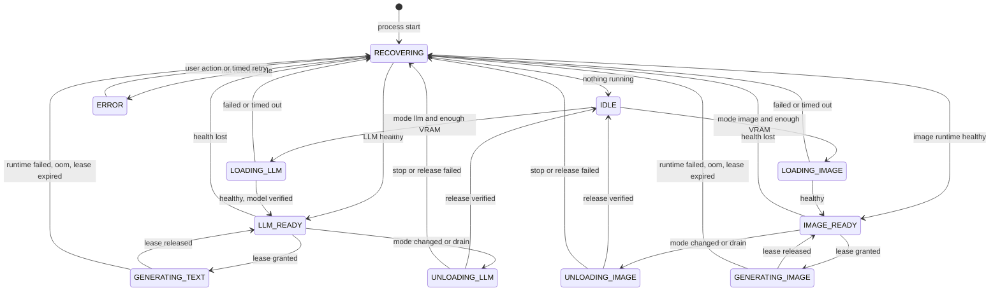

# GPU orchestration: Model Lifecycle Manager

Status: accepted (2026-11-01), revised 2026-11-05 for selectable model profiles. Implementation: planned, phases P01, P02, P05 and P06.

The text model and the image model never share the GPU, whichever [profiles](models.md) are active. The orchestrator owns the GPU state and the two runtime containers. The backend owns the durable
job queue and asks the orchestrator for a mode and a lease
([ADR 0004](decisions/0004-single-sqlite-writer.md), [ADR 0005](decisions/0005-exclusive-gpu-by-container-lifecycle.md)).

## Normal state

| Component | State |
| --- | --- |
| `lyrveil-frontend`, `lyrveil-backend`, `lyrveil-orchestrator` | Running |
| `lyrveil-llm` | Running, the active text profile loaded, state `LLM_READY` |
| `lyrveil-image` | Created, stopped, no GPU allocation |

When the queue is empty, the desired mode is always `llm`.

## State machine



`state_machine.py` holds this table as data. It is pure and has no I/O. Any other transition raises `IllegalTransition`, is logged and is rejected.

| State | Meaning | Containers |
| --- | --- | --- |
| `IDLE` | No model in the GPU, verified | Both stopped |
| `LOADING_LLM` | KoboldCpp starting | LLM starting |
| `LLM_READY` | Text model loaded, no lease | LLM healthy |
| `GENERATING_TEXT` | A text lease is active | LLM healthy |
| `UNLOADING_LLM` | Stopping and verifying release | LLM stopping |
| `LOADING_IMAGE` | ComfyUI starting | Image starting |
| `IMAGE_READY` | ComfyUI ready, no lease | Image healthy |
| `GENERATING_IMAGE` | An image lease is active. The checkpoint loads here on first use | Image healthy |
| `UNLOADING_IMAGE` | Stopping and verifying release | Image stopping |
| `RECOVERING` | Reconciling with reality | Any |
| `ERROR` | Needs a user action or a timed retry | Both stopped when possible |

### Exclusivity rules

1. `LOADING_*` can be entered only from `IDLE`.
2. `IDLE` can be entered only after a verified release.
3. Immediately before starting a runtime, `ProcessSupervisor` inspects the other container. If it runs, the start is refused and the state becomes `RECOVERING`.
4. Leases exist only in the matching mode. A lease cannot outlive a mode change.

A property test with Hypothesis drives random sequences of events through the table and asserts that no path can reach both runtimes running.

## The 18 steps of an image request

| # | Requirement | Where | State |
| --- | --- | --- | --- |
| 1 | Receive the request | `POST .../images` or the detector | `LLM_READY` |
| 2 | Create a persistent job | `generation_jobs`, same transaction as the user message | `LLM_READY` |
| 3 | Prepare the visual prompt with the text model | Stage `prompt`, under a text lease | `GENERATING_TEXT` |
| 4 | Save context and chat state | Already durable: each message and the stage result are committed | `LLM_READY` |
| 5 | Finish running LLM work | The scheduler runs nothing else. Foreground work finishes, background work is aborted and requeued | `LLM_READY` |
| 6 | Stop the KoboldCpp container | `PUT /v1/desired-mode image`, then `POST .../stop?t=20` | `UNLOADING_LLM` |
| 7 | Wait for GPU memory release | [Release verification](#verifying-gpu-release) | `UNLOADING_LLM` to `IDLE` |
| 8 | Start the ComfyUI container | Allowlisted start, after the VRAM check | `LOADING_IMAGE` |
| 9 | Wait until it is ready | Docker health check on `/system_stats` | `LOADING_IMAGE` to `IMAGE_READY` |
| 10 | Load the image checkpoint | First workflow node. ComfyUI loads the active profile's checkpoint on demand | `GENERATING_IMAGE`, phase `loading` |
| 11 | Run the workflow | Image lease, `POST /prompt`, WebSocket progress | `GENERATING_IMAGE` |
| 12 | Save the image to the persistent store | Fetch to staging. Stage `persist` moves it to `data/media` | `IMAGE_READY` |
| 13 | Update the message | One transaction with `generated_images` | `IMAGE_READY` or later |
| 14 | Stop ComfyUI | Desired mode returns to `llm`, then `POST .../stop?t=30` | `UNLOADING_IMAGE` |
| 15 | Verify GPU release | Same procedure | `UNLOADING_IMAGE` to `IDLE` |
| 16 | Restart KoboldCpp | Allowlisted start | `LOADING_LLM` |
| 17 | Reload the text model | KoboldCpp loads the model before serving, so health implies loaded. `GET /api/v1/model` confirms the file of the active profile | `LOADING_LLM` to `LLM_READY` |
| 18 | Resume queued conversation work | Scheduler selects queued text jobs in order | `GENERATING_TEXT` |

Steps 12 and 13 may finish after step 14, because `persist` needs no GPU and uses the staged file.

Planning target for a full switch from LLM to image and back: under 150 seconds. P06 measures it with the default profiles.

With 32 GB of RAM, the page cache usually still holds the text model's file when it reloads, so step 17 reads from memory
rather than from disk. The mixture-of-experts profiles load more data than the 12B profiles, and P06 records both.

A change of the active text profile uses the same states: the desired mode goes to `none`, the runtime stops and its
release is verified, then the desired mode returns to `llm` and the runtime starts with the new launch file. See
[Selecting a profile](models.md#selecting-a-profile).

## Leases and the global lock

A lease is the global GPU lock. At most one exists.

| Rule | Value |
| --- | --- |
| Time to live | 30 s |
| Heartbeat | Every 10 s while a job runs |
| Expiry | Moves to `RECOVERING`. The next ready state needs the job to restart |
| Release outcome | `ok`, `oom`, `runtime_error` |
| Backend restart | The lease expires by itself |
| Orchestrator restart | The lease is gone. The next heartbeat returns `410`, and the job retries with `LEASE_LOST` |

All backend access to a runtime goes through an adapter that refuses to act without a current lease of the right mode.

## Scheduling rules

The backend's `JobScheduler` selects jobs. The queue is durable, so nothing is lost on restart.

### Job kinds and priorities

Lower numbers run first. Values are configurable under `jobs.priority.*`.

| Kind | `required_mode` | Priority | Class | Max attempts |
| --- | --- | --- | --- | --- |
| `chat_reply`, `chat_regenerate` | `llm` | 10 | Foreground | 2 |
| `character_draft` | `llm` | 20 | Foreground | 2 |
| `image_request` | By stage | 30 | Foreground | 2 |
| `visual_profile_translate` | `llm` | 40 | Foreground | 2 |
| `proactive_message` | `llm` | 50 | Soft | 2 |
| `image_proposal` | `llm` | 60 | Background | 1 |
| `summary_checkpoint` | `llm` | 70 | Background | 3 |
| `memory_extraction`, `memory_reevaluation` | `llm` | 80 | Background | 3 |
| `maintenance` | `none` | 90 | Background | 1 |

### Selection

```text
when a job finishes or arrives:

  in text mode:
    if the oldest image job has waited at least images.max_wait_seconds (60):
        change mode to image
    elif a foreground text job is queued:
        run the best one
    elif an image job is queued:
        change mode to image
    elif a soft or background job is eligible and the user was idle for jobs.background_idle_seconds (20):
        run the best one
    else:
        stay in text mode

  in image mode:
    if a foreground text job is queued:
        finish the running image, then change mode to text
    elif an image job is queued and images_in_a_row < images.max_in_a_row (4):
        run it
    else:
        change mode to text
```

An `image_request` in stage `prompt` counts as a foreground text job. In stage `render` it is an image job, and its wait starts when it enters that stage.

Consequences:

- Soft and background work never causes a mode change.
- A text message during image generation is saved at once, queued, shown as queued and handled when the text model returns.
- Replies from different conversations run one at a time, oldest first within a priority.
- No second instance of a model ever starts.

### Preemption

When a foreground job arrives during background generation, the scheduler calls `POST /api/extra/abort` with the job's `genkey` and requeues the job. No attempt is consumed, and extraction
is idempotent, so no data is affected. A running foreground reply is never preempted. An image job waits for it. If the reply exceeds the
drain limit of 120 s, it is aborted and requeued.

### Cancellation

| Job state | Effect |
| --- | --- |
| Queued | `cancelled` at once. The placeholder is removed |
| Running text | `POST /api/extra/abort`. Partial text stays and the status becomes `interrupted` |
| Running image | `POST /interrupt`. The placeholder is removed |

## Verifying GPU release

NVML cannot list compute processes on WSL2 ([Runtime contracts](runtime-contracts.md#nvml-and-wsl2)), and other programs can hold VRAM. Therefore total free memory is not treated as proof.

Procedure after a stop:

1. **Container state, authoritative.** `State.Running` is false and the container reports an exit code. `top` has no processes to report. If it still runs after the grace period, Docker has
   already sent SIGKILL. Failure here goes to `RECOVERING`.
2. **Memory settles.** Sample NVML every 500 ms. Three consecutive samples within 64 MiB of each other mean that the memory has settled. The limit is 60 s.
3. **Expected drop, informational.** `used_before_stop - used_now` is compared with the footprint measured at load. The result goes into the event log. A smaller drop can have an external
   cause, so it does not fail the check.
4. Enter `IDLE`.

Before any load:

| Check | LLM | Image |
| --- | --- | --- |
| Hard requirement, free VRAM | `vram_required_mib` of the active text profile. Planning value 7000 for the 26B-A4B profiles and 6000 for the others | `vram.required_image_mib` = 6500 |
| Preferred | `vram_preferred_mib` of the profile. Planning value 10000 for the 26B-A4B profiles and 9000 for the others. Below it the app warns of slower replies, because autofit keeps fewer weights on the GPU | Not applicable |

When free VRAM is below the requirement, the state stays `IDLE` with `blocked_reason = GPU_INSUFFICIENT_VRAM`. The check repeats every 5 s for `vram.wait_seconds` (120). Then the waiting job fails with a message
that names the numbers, and the next job can try. **External processes are never terminated.** The interface suggests closing other programs that use the card.

The defaults are planning values. After measuring, P02 and P05 set each requirement to the measured peak plus 5 %, and record the result in the catalog.

## Load failures and launch levels

The launch settings are in `runtime/llm-launch.env` and `runtime/image-launch.env` in the data volume. The backend writes them, and the containers read them at start. See
[Configuration](configuration.md#launch-files). No container needs to be recreated to change them.

These launch levels are separate from model profiles. Each level derives from the active profile's context size:

| Level | Context | Batch | GPU layers | Gemma 4 profiles | Mistral Nemo profiles |
| --- | --- | --- | --- | --- | --- |
| A, default | Profile value | 512 | Autofit | 16384 | 8192 |
| B | Three quarters | 512 | Autofit | 12288 | 6144 |
| C | Half | 256 | Autofit | 8192 | 4096 |

| Event | Action |
| --- | --- |
| LLM exits with status 3, or logs match the allocation failure patterns | `LLM_LOAD_FAILED` with `oom = true`. The backend moves to the next level. |
| `LLM_OOM` during generation | Same. The job retries. |
| LLM fails without an allocation error | Same level. Retries after 5 s and 20 s. |
| Three failures in a row | `ERROR`. Retries every 300 s, at most 3 times per hour, or on the user's action. |
| Level below A in use | The interface shows it in the settings. `GET /api/extra/true_max_context_length` sizes the budgets. The user can return to A. |
| `IMAGE_OOM` | One retry with the tiled workflow of the same preset, after a runtime restart. Then **Rapida** once. See [Image failures](image-generation.md#failures). |
| Model file missing or with the wrong size | `MODEL_FILE_MISSING` before any mode change. Nothing is stopped. The settings screen shows the download command. |
| `IMAGE_LOAD_FAILED` | Retry after 5 s and 20 s. Then the job fails, and the mode returns to text. |

### Measuring and tuning

The P02 procedure, with the result in `docs/verification/`. It runs for `gemma-4-26b-a4b`, `gemma-4-12b` and
`rocinante-x-12b`, and the other profiles reuse the result of the profile with the same architecture:

1. Close other GPU programs and record the baseline.
2. Load level A. Record used VRAM after load, RAM used by the container, and the peak VRAM during 20 generations.
3. `margin = total - peak`.
4. If the margin is under 512 MiB, make level B the default for that profile.
5. If the margin is at least 1024 MiB, the profile's context may grow by one step, only if the margin after the
   increase stays at least 1024 MiB. Gemma 4 grows to 24576, Mistral Nemo to 12288.
6. Compare batch 256, 512, 1024 and 2048 on prompt processing speed. Keep 512 unless another value gains at least
   20 % and the margin rule still holds. With experts in RAM, a larger batch may move fewer weights per token.
7. **Speed rule for the mixture-of-experts default.** Over 20 replies of at least 200 tokens, the median generation
   speed must be at least 15 tokens per second. The first token of a new 6000-token prompt must arrive within 20 s.
   Compare AutoFit with `MOE_CPU_LAYERS` values 8, 12 and 16, and keep the fastest setting that meets the margin rule.
   If no setting meets the speed rule, `gemma-4-12b` becomes the default on every tier
   ([Model catalog](models.md#defaults-and-how-they-can-change)).
8. **Memory mapping.** Load with `USE_MMAP` 0 and 1. Record RAM used by the container, reload time after an image
   job, and generation speed. Keep 1 for the profile if it saves at least 2 GiB of RAM or 20 % of reload time, and
   costs at most 5 % of speed.
9. **KV cache type.** Load with `KV_QUANT` `f16` and `q8_0`. Record VRAM and speed. `q8_0` becomes the profile's
   value only if it frees at least 256 MiB or allows the next context step, costs at most 5 % of speed, and the P04
   Italian protocol scores no lower. Until P04, `f16` stays ([ADR 0030](decisions/0030-koboldcpp-efficiency-levers.md)).

P04 adds two measurements with real chat prompts from the consistency protocol, because they depend on the prompt
layout ([ADR 0031](decisions/0031-stable-prefix-dynamic-context-and-anchor.md)):

- **SWA padding** for the Gemma 4 profiles: `SWA_PADDING` 0, 1024 and 2048. Keep the smallest value whose median
  `last_process` is within 10 % of the best, while the margin rule and the speed rule still hold.
- **SmartCache** on the target tier: `SMART_CACHE` 0 and 2. Use 2 if the median `last_process` of the first chat
  reply after a structured task falls by at least 50 %, and the container's peak RAM stays at least 4 GiB below the
  memory Docker sees.

## Timeouts

| Setting | Default |
| --- | --- |
| `gpu.llm_load_timeout_s` | 240 |
| `gpu.image_load_timeout_s` | 180 |
| `gpu.llm_stop_grace_s` | 20 |
| `gpu.image_stop_grace_s` | 30 |
| `gpu.release_timeout_s` | 60 |
| `gpu.llm_drain_timeout_s` | 120 |
| `jobs.text_total_timeout_s` | 180 |
| `jobs.text_stall_timeout_s` | 60 |
| `jobs.image_total_timeout_s` | 300 |
| `jobs.image_stall_timeout_s` | 120 |

## Recovery

`RECOVERING` compares reality with the rules:

| `lyrveil-llm` | `lyrveil-image` | Action |
| --- | --- | --- |
| Healthy | Stopped | `LLM_READY` |
| Stopped | Healthy | `IMAGE_READY` |
| Running | Running | Log `EXCLUSIVITY_VIOLATION`, stop the image runtime, verify release, then `LLM_READY` when healthy |
| Unhealthy | Any | Stop it, verify release, then `IDLE` |
| Any | Unhealthy | Same |
| Stopped | Stopped | `IDLE` |
| Container missing | Any | `ERROR` with `RUNTIME_CONTAINER_MISSING`. The message says to run `.\setup.cmd` |
| Docker unreachable | Docker unreachable | `ERROR` with `DOCKER_UNAVAILABLE`, automatic retry |

## Safe shutdown

`stop.cmd` follows this order:

1. Backend pauses the queue and lets a running reply finish, for up to 60 s.
2. `POST /v1/drain`: the orchestrator stops the runtime and verifies release.
3. `docker compose --profile ai stop`.

Each process handles SIGTERM. Containers use `init: true`, so children are reaped and no orphan process keeps VRAM. P06 verifies this with NVML and `top`.

## Monitoring and logs

- Every transition emits an event: `seq`, `from`, `to`, `reason`, `job_id`, VRAM values and time. It is logged as JSON and buffered for the backend, which stores it in `model_lifecycle_events`.
- The **Risorse AI** screen shows state, VRAM, queue, tokens per second and recent transitions. It shows only real values.

## Interface labels

| State or case | Italian text |
| --- | --- |
| `LLM_READY`, `GENERATING_TEXT` | No text. The conversation shows only the typing indicator |
| Text queued during image work | In coda: risponderà appena finisce l'immagine |
| `UNLOADING_LLM`, `LOADING_IMAGE` | In attesa della scheda video… |
| `GENERATING_IMAGE` | Sta disegnando… |
| `UNLOADING_IMAGE`, `LOADING_LLM` | Sta tornando in chat… |
| `RECOVERING` | Sto riprendendo il controllo della scheda video… |
| `ERROR` | La scheda video non risponde. Riprova |
| `GPU_INSUFFICIENT_VRAM` | Altri programmi stanno usando la scheda video. Chiudili e riprova |
