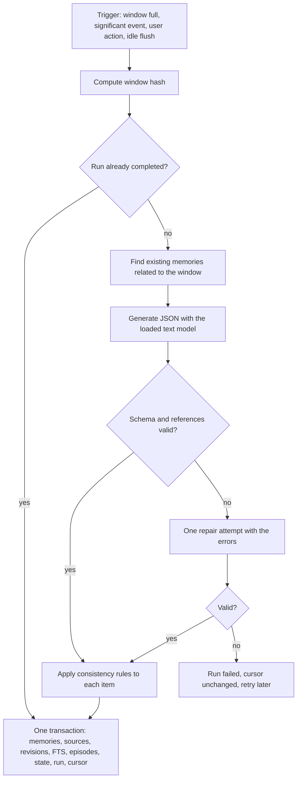

# Lyrveil Memory Engine

Status: accepted (2026-11-01), revised 2026-11-06 for the prompt layout. Implementation: planned, phase P04.

The engine keeps what a character should remember. It lives in SQLite and never depends
on a model staying in the GPU, so memory survives restarts, model switches and very long
conversations.

## Memory layers

| Layer | Content | Storage | Changed by |
| --- | --- | --- | --- |
| A. Identity | Canonical definition | `characters`, `character_traits`, `character_visual_profiles`, `character_versions` | The user only |
| B. Shared | Facts valid across chats of one character | `memories` with `scope = shared` | The user only, with "Condividi" |
| C. Conversation | Facts learned in one chat | `memories` with `scope = conversation` | Extraction, the user |
| D. Episodic | Significant events | `episodic_memories`, `episodic_sources`, `episode_links` | Extraction, the user |
| E. Relationship | How the relationship developed | `relationship_states`, `character_state_history` | `CharacterStateManager` |
| F. Working | Context of the current message | Rebuilt per message. Trace in `prompt_assemblies` | `ContextBuilder` |

Full history stays in `messages` and `message_variants`. Structured memory holds only
what is useful.

### Shared memory

Sharing is opt-in on both sides:

- A conversation reads shared memories only when `shares_memory = 1`. The default is 0.
- A memory enters the shared scope only through the user's "Condividi" action, which
  copies it and sets `origin_conversation_id`.
- Extraction never writes to the shared scope.

## The memory record

| Requirement | Representation |
| --- | --- |
| Stated fact | `provenance = stated` |
| Model inference | `provenance = inferred`, confidence at most 0.6 |
| Fictional narrative element | `provenance = fictional` |
| Temporary information | `durability = temporary`, `expires_at` set |
| Contradicted information | `status = contradicted`, `superseded` or `uncertain` |
| Confirmed by the user | `provenance = user_confirmed`, confidence 1.0 |

The columns are in [Data model](data-model.md#memories). Status meanings:

| Status | Used in prompts | Meaning |
| --- | --- | --- |
| `active` | Yes | Currently valid according to its provenance. |
| `uncertain` | Yes, labeled uncertain | Part of an unresolved conflict. |
| `superseded` | Only when the user asks about the past | A newer fact replaced it. |
| `contradicted` | No | Disproved with no replacement. |
| `expired` | No | Past its `expires_at`. |
| `invalidated` | No | Its sources were edited or deleted. Awaits re-evaluation. |

Confidence comes from the model as `low`, `medium` or `high` and is stored as 0.4, 0.7 or
0.95, then capped by the provenance rules.

## Extraction pipeline



### Triggers

| Trigger | Condition |
| --- | --- |
| Window | `memory.extract_every_messages` unprocessed messages. Default 10, allowed 8 to 12. |
| Significant event | The user message matches `prompts/it/significant_patterns.txt` and at least 2 messages are unprocessed. Examples: `ricordati`, `non dimenticare`, `ho cambiato`, `mi sono trasferit`, `ti prometto`, `ho deciso`. |
| User action | "Ricorda questo" on a message. |
| Idle flush | The conversation is idle for 15 minutes with at least 4 unprocessed messages. |
| Re-evaluation | A source message changed. See [Invalidation](#invalidation-after-message-changes). |

Extraction uses the already loaded model. Its jobs are eligible only in `LLM_READY`, never
cause a mode change and yield to any foreground job
([scheduling](gpu-orchestration.md#scheduling-rules)).

### Window

- From `last_extracted_seq + 1` to the newest complete message, at most 12 messages.
- The 2 previous messages are added as read-only context.
- `window_hash` covers the identifier and content hash of each active variant.

### Idempotency and failure

- `memory_extraction_runs` is unique on window hash, prompt version and schema version. A
  completed run is never repeated.
- Memory writes and the advance of `last_extracted_seq` share one transaction.
- A failure changes no memory and no cursor. Messages are never touched. The job retries
  after 1, 5 and 30 minutes.
- `raw_output` stays local for debugging and is removed after 30 days.

### Output schema

The grammar and the validator derive from these models. See
[ADR 0013](decisions/0013-structured-output-grammar-and-validation.md).

```python
class ExtractedMemory(BaseModel):
    relation: Literal["new", "duplicate", "update", "contradiction", "temporary", "correction"]
    target_ref: str | None = None          # "E3": an existing memory shown in the prompt
    kind: MemoryKind
    content: Annotated[str, StringConstraints(min_length=3, max_length=280)]
    subject: str | None = None             # "user.employer"
    value: str | None = None               # "Studio Rossi"
    provenance: Literal["stated", "inferred", "fictional"]
    durability: Literal["lasting", "temporary"]
    valid_until: date | None = None
    importance: Annotated[int, Field(ge=1, le=5)]
    confidence: Literal["low", "medium", "high"]
    source_seqs: Annotated[list[int], Field(min_length=1, max_length=8)]


class ExtractedEpisode(BaseModel):
    title: Annotated[str, StringConstraints(min_length=3, max_length=120)]
    description: Annotated[str, StringConstraints(min_length=3, max_length=600)]
    participants: list[str]
    importance: Annotated[int, Field(ge=1, le=5)]
    source_seqs: Annotated[list[int], Field(min_length=1, max_length=12)]
    linked_episode_refs: list[str] = []    # "P1": a recent episode shown in the prompt


class RelationshipEvent(BaseModel):
    dimension: Literal["familiarity", "trust", "confidence", "tension"]
    direction: Literal["up", "down"]
    magnitude: Literal["small", "medium", "large"]
    reason: Annotated[str, StringConstraints(min_length=3, max_length=200)]
    source_seqs: Annotated[list[int], Field(min_length=1, max_length=6)]


class StateUpdate(BaseModel):
    emotional_state: str | None = None
    current_topic: str | None = None
    open_threads_add: list[str] = []
    open_threads_close: list[str] = []
    goals: list[str] = []
    narrative_change: str | None = None


class ExtractionResult(BaseModel):
    schema_version: Literal[1]
    memories: Annotated[list[ExtractedMemory], Field(max_length=12)]
    episodes: Annotated[list[ExtractedEpisode], Field(max_length=3)]
    relationship_events: Annotated[list[RelationshipEvent], Field(max_length=4)]
    state: StateUpdate
```

The prompt shows existing memories as `E1..En` and recent episodes as `P1..Pn`. The service
maps these labels to real identifiers. A reference to an unknown label, or a `source_seqs`
value outside the window, drops that item and increments a counter.

### Consistency rules

`MemoryConsistencyService` applies these to each item before writing. The model only
proposes. These rules decide.

| Relation | Check | Action |
| --- | --- | --- |
| `new` | No active memory with the same fingerprint, no blocking tombstone | Insert. |
| `duplicate` | Target exists | Add sources. Raise importance to the higher value. Same fingerprint, no new version. |
| `update` | Target exists, same subject, source newer than the target's sources | Target becomes `superseded` with `valid_to` and `superseded_by_id`. New memory with `valid_from`. |
| `contradiction` | Target exists, and the change is unclear | Both become `uncertain` in one `conflict_group_id`. A `memory.conflict` event fires when importance is at least 3. |
| `temporary` | `valid_until`, or 7 days by default | Insert with `expires_at`. It never supersedes a lasting fact. |
| `correction` | A source message is by the user | Target becomes `superseded`. New memory with `provenance = user_confirmed`, confidence 1.0. |

Guards applied after the table:

1. **Provenance check.** A `stated` memory about the user needs a source message by the
   user. Otherwise it becomes `inferred`. A fact the character states about itself in the
   chat becomes `fictional`.
2. **Inference limit.** An inference never supersedes a stated or confirmed memory. A
   conflict places the inference in `uncertain`.
3. **Deterministic conflict.** Two active memories with the same single-valued `subject_key`
   and different values never coexist as active, whatever the model said. An explicit change
   cue, such as `ho cambiato` or `ora lavoro`, makes it an `update`. Otherwise it is a
   `contradiction`. The single-valued list is `user.name`, `user.age`, `user.city`,
   `user.employer`, `user.job`, `user.partner` and `user.birthday`.
4. **Lock.** A locked target is never changed. New information becomes `uncertain` with
   `needs_review`.
5. **Identity.** Information that would change canonical data is stored only with
   `kind = identity_candidate`. It never enters prompts. The Memory Studio offers
   "Applica al profilo", which creates a new character version after the user's review.
6. **Tombstone.** See below.

### Deduplication

The fingerprint is a SHA-256 of normalized content: lowercase, accents removed, punctuation
removed, stop words removed, stemmed, tokens sorted. Two memories of the same kind and
subject with a stem-set Jaccard similarity of at least 0.8 also count as duplicates.

### Deletion and tombstones

Deleting a memory removes its text. A tombstone keeps the fingerprint, subject key, value
hash, source hashes and newest source sequence.

A candidate is blocked when both hold:

- its fingerprint matches a tombstone, or its subject key and value hash match one;
- every source is at or before `source_max_seq`, or its content hash is listed in the
  tombstone.

A later message that states the same fact is new information, so the memory can return.

### Worked example: a job change

| Moment | Message | Result |
| --- | --- | --- |
| March | "Lavoro allo Studio Rossi." | `user.employer = Studio Rossi`, `stated`, `active`, source 112. |
| June | "Ho cambiato lavoro, ora sono da Verdi & Co." | Rossi becomes `superseded`, `valid_to` June. New `user.employer = Verdi & Co`, `active`, source 480. |
| June | Prompt | Shows only `[sicuro] Lavora da Verdi & Co.` |
| June | "Dove lavoravo prima?" | Past intent. Also shows `[passato] Lavorava allo Studio Rossi fino a giugno.` |
| July | "Non so se resto da Verdi o torno da Rossi." | Reported doubt. Both stay as they are, plus a `temporary` memory that the user is undecided. |

## Retrieval

### Stemming

FTS5 has no Italian stemmer, so Python prepares the text:

1. Normalize with NFKC and lowercase.
2. Split into word tokens with the `\w+` pattern.
3. Remove stop words, from a list stored per language in the repository.
4. Stem with `snowballstemmer`: `italian`, `english`, `french`, `german`, `spanish`.

The indexed column stores the stems. The tokenizer `unicode61 remove_diacritics 2` handles
accents. Queries use the same steps. Each stem is quoted and joined with `OR`, so raw user
text never reaches FTS query syntax. Unknown languages skip the stemming step.

### Retrieval contract

The brief's `retrieveRelevantMemories` is `retrieve_relevant_memories` in Python, following
PEP 8. `FtsMemoryRetriever` is the 1.0 implementation.

```python
@dataclass(frozen=True)
class RetrievalQuery:
    character_id: str
    conversation_id: str
    text: str                       # Latest user message and the two turns before it
    topic: str | None
    language: str
    token_budget: int
    now: datetime
    include_shared: bool            # conversations.shares_memory
    past_intent: bool               # The user is asking about the past
    previous_ids: frozenset[str]    # Selection used for the previous reply
    max_items: int = 24


class MemoryRetriever(Protocol):
    def retrieve_relevant_memories(self, query: RetrievalQuery) -> RetrievalResult:
        """Return the best memories and episodes that fit `token_budget`.

        Results always belong to `character_id`, and to `conversation_id` or, when
        `include_shared` is true, to the shared scope. Each item holds its score parts
        for diagnostics. An empty result is valid. Raises only on a database failure.
        """
```

A semantic or hybrid retriever implements the same Protocol. No caller changes.

### Candidates

SQL filters always apply, before any ranking:

- `character_id` matches;
- `conversation_id` matches, or `scope = shared` when `include_shared` is true;
- `status IN ('active', 'uncertain')`, plus `superseded` when `past_intent` is true;
- not expired;
- `kind <> 'identity_candidate'`.

Candidates come from two routes: up to 64 FTS matches, and up to 16 standing memories that
apply regardless of the words used (locked memories, importance 5, `boundary`, and active
`promise` and `open_thread` kinds).

### Scoring

```text
score = 0.40 fts + 0.20 importance + 0.15 recency + 0.10 topic + 0.10 kind + 0.05 confidence
score = score × status_factor
score = min(1, score + 0.10 if locked + 0.05 if in previous_ids)
```

| Part | Formula |
| --- | --- |
| `fts` | 0 without a match. With a match, `0.5 + 0.5 × (s - s_min) / (s_max - s_min)`, where `s = -bm25(memory_fts, 0.0, 2.0, 1.0)` over this candidate set (one weight per column, including the unindexed identifier), and 1.0 when all are equal. BM25 gives near-zero values on small tables, so absolute values cannot be used. |
| `importance` | `(importance - 1) / 4` |
| `recency` | `exp(-ln2 × age_days / 30)` on `updated_at`. Floor 0.5 for locked memories and importance 5. |
| `topic` | Share of the current topic's stems found in the memory. |
| `kind` | `boundary` 1.0, `promise` 0.9, `open_thread` 0.9, `user_preference` 0.8, `user_fact` 0.8, `decision` 0.7, `narrative_event` 0.6, `character_fact` 0.6 |
| `confidence` | The stored value. |
| `status_factor` | `active` 1.0, `uncertain` 0.8, `superseded` 0.7 |

All weights are settings (`memory.retrieval.*`). The bonus for `previous_ids` keeps the
selection stable between turns, which keeps the prompt prefix stable and the reply fast.

### Selection

1. Sort by score, highest first.
2. For one subject keep the best memory. Members of one conflict group stay together.
3. Allow at most 6 items per kind and 3 episodes.
4. Add items while their token cost fits the budget, up to `max_items`.
5. Update `last_used_at` and `use_count` after the reply is committed.

### Past intent

`past_intent` is true when the latest user message matches a cue list stored per language.
Italian examples: `prima`, `una volta`, `l'anno scorso`, `ai tempi`, `ti ricordi quando`,
and imperfect forms with `lavoravo` or `abitavo`.

### Prompt rendering

```text
Ricordi pertinenti:
- [sicuro] Lavora da Verdi & Co. da giugno.
- [incerto] Forse ha un fratello di nome Luca.
- [storia] Avete trovato una mappa nascosta al porto vecchio.
- [per ora] Questa settimana dorme da sua sorella.
- [passato] Lavorava allo Studio Rossi fino a giugno.
- [episodio] La notte al faro: siete rimasti svegli a parlare del suo trasloco.
```

| Label | Applied to |
| --- | --- |
| `[sicuro]` | `stated` or `user_confirmed`, `active` |
| `[incerto]` | `inferred`, or `uncertain` status |
| `[storia]` | `fictional` |
| `[per ora]` | `temporary` |
| `[passato]` | `superseded` under past intent |
| `[episodio]` | Episodes |

## Contradictions

| Situation | Recognized as | Result |
| --- | --- | --- |
| Nothing similar exists | New information | Insert |
| Same fact, same value | Duplicate | More sources |
| A later message changes a single-valued fact | Update | History kept, new version in use |
| Values conflict, with no clear change | Contradiction | Both uncertain, shown as uncertain |
| "Questa settimana sono a Roma" | Temporary | Expires, and the lasting fact stays |
| "No, non ho detto questo: ho due gatti" | User correction | Previous memory superseded, new one confirmed |

The Memory Studio lists conflicts. `POST /memories/{id}/resolve` keeps the chosen memory and
marks the others `contradicted`, with a revision for each. History is never silently
removed, and source references stay in place.

## Progressive summaries

Each checkpoint covers a message range. Originals are never replaced.

| Rule | Value |
| --- | --- |
| Recent tail excluded from summaries | The newest 30 messages |
| Level 0 chunk | 40 messages, or at least 2400 tokens |
| Rollup | When 6 consecutive checkpoints of one level exist, the oldest 4 become one checkpoint of the next level. Their rows stay. |
| Eligibility | `LLM_READY` only, never in image mode, never causes a mode change |
| Cursor | `last_summarized_seq` advances with the checkpoint in one transaction |

Output:

```python
class SummaryResult(BaseModel):
    schema_version: Literal[1]
    text: Annotated[str, StringConstraints(max_length=1600)]
    events: list[str]
    decisions: list[str]
    relationship_changes: list[str]
    unresolved: list[str]
    key_facts: list[str]
    source_seqs: list[int]
```

Re-summarizing a range creates a new version and marks the old one `superseded`.

### Choosing summaries for a prompt

The budget is `context.summary_target_tokens`. The builder takes:

1. The newest checkpoint immediately before the recent messages.
2. Earlier checkpoints, walking backward, while they fit and the coverage stays contiguous.
3. When room remains and an older range is uncovered, the highest-level rollup of up to 200
   tokens.

`invalidated` checkpoints are never used. A gap in coverage is allowed and is logged in the
prompt assembly.

## Context composition

`ContextBuilder` builds the blocks below. `PromptFormatter` places them in four parts, from most to
least stable ([ADR 0031](decisions/0031-stable-prefix-dynamic-context-and-anchor.md)):

1. **Stable system text**: blocks 1, 2, 3 and 6.
2. **History**: block 7, as plain turns.
3. **Dynamic context**: blocks 4, 5 and 9, in a fixed frame inside the last user turn.
4. **Current message**: block 8.

| # | Block | Part | Priority when over budget | Min | Target | Max |
| --- | --- | --- | --- | --- | --- | --- |
| 1 | Global instructions | Stable | Never reduced | 250 | 350 | 450 |
| 2 | Canonical identity | Stable | Required fields never reduced | 250 | 700 | 900 |
| 3 | Communication profile | Stable | Examples cut first | 80 | 350 | 500 |
| 4 | Conversation state and time | Dynamic | Details reduced late | 60 | 200 | 300 |
| 5 | Relevant memories | Dynamic | Lowest scores cut | 0 | 900 | 1400 |
| 6 | Contextual summary | Stable | Older parts cut | 0 | 600 | 900 |
| 7 | Recent messages | History | Oldest cut, floor 800 | 800 | Remainder | Remainder |
| 8 | Current message | Current | Never reduced in normal use | Actual | Actual | 2048 |
| 9 | Anchor | Dynamic | Never reduced | 60 | 110 | 160 |
| - | Reserved for the reply | | The band's `max_length`, see [Length bands](prompting.md#length-bands) | 60 | | 400 |
| - | Safety margin | | Fixed | | 64 | |

With a window of 8192, the targets of blocks 1 to 6 and 9 total 3210 tokens. The reply, at most
400, and the margin take up to 464, so about 4500 tokens remain for messages.

### Algorithm

```text
limit = true context size reported by the runtime
reply_reserve = max_length of the character's length band
available = limit - reply_reserve - safety_margin
render blocks 1, 2 (required), 3 (core), 8, 9; count tokens
allocate block 4 at target
query memories with budget = target of block 5
choose summaries with budget = target of block 6
fill block 7 from newest to oldest with everything left
if block 7 ended before the oldest message would be needed:
    give spare tokens to memories, then summary, up to their max
assemble and count the full prompt with the runtime
while total > available (at most 3 rounds):
    apply the next reduction
record the assembly, send the prompt
```

Reduction order: message examples, oldest summary parts, lowest-scoring memories, oldest
recent messages down to the floor, optional identity fields not locked (interests,
background details), state details.

Never removed: global instructions, first name, age, grammatical gender, narrative identity,
main traits, values, the core style description, the anchor and the current message. A current message over 2048 tokens is
truncated in the prompt only, with a visible note in the interface. The API limit of 8000
characters keeps this rare.

### Token counting

- `POST /api/extra/tokencount` is the authority.
- `messages.token_count` caches per message, with `tokenizer_id`. A model change recounts.
- Blocks are cached in memory by content hash.
- The final prompt is always counted as a whole, with `special: true`.
- A length estimate may only choose how many messages to count next. It never decides that
  a prompt fits.

### Prefix stability

KoboldCpp reuses the cached part of the prompt up to the first changed token. To keep that part long:

- Everything that changes on most turns (state, time, memories and the anchor) is placed after the
  history, in the last user turn. Old turns are rendered without it, so the stable text and the history
  stay byte-identical between replies ([ADR 0031](decisions/0031-stable-prefix-dynamic-context-and-anchor.md)).
- The summary changes only at a checkpoint, so it stays in the stable text.
- Time context uses coarse values such as "stasera" and "tre giorni fa".
- The bonus for `previous_ids` avoids needless memory churn.
- State changes only after extraction.

A reply therefore reprocesses the previous exchange and the new dynamic context, about 1,000 to 2,500
tokens. Gemma 4 profiles keep a sliding-window cache, so KoboldCpp also replays up to 2,048 cached tokens
when the reuse point lies beyond that cache. SWA padding and SmartCache are measured levers for this
([Runtime contracts](runtime-contracts.md#flags)).

P04 measures the prompt processing time with `last_process` from `/api/extra/perf`, for this layout and
for a single system text.

## Working memory

Layer F is the result of the builder:

```python
@dataclass(frozen=True)
class WorkingMemory:
    recent_messages: list[MessageView]
    situation: str              # Scenario, emotional state, time context
    current_topic: str | None
    memories: list[RetrievedMemory]
    goals: list[str]
    pending: list[str]          # Open threads and planned events
```

## Invalidation after message changes

`MessageService` notifies `MemoryConsistencyService` when a message is edited or deleted, or
when another variant becomes active.

1. Find memories, episodes, state rows and summaries that used the old variant.
2. **Memories.** A locked memory only gets `needs_review`. If other valid sources remain, drop
   this one and lower confidence by 0.1. Otherwise set `status = invalidated`.
3. **Episodes.** Same logic.
4. **State.** Mark rows `invalidated` and replay the state from the remaining rows.
5. **Summaries.** Mark every checkpoint covering that sequence `invalidated`, and queue
   `summary_checkpoint`.
6. **Re-evaluation.** Queue `memory_reevaluation` for the window from `seq - 6` to `seq + 6`. The
   new content produces a new `window_hash`, so the run is real.
7. A re-extracted fingerprint that matches an `invalidated` memory reactivates that row with a
   new revision and new sources.

Everything except the model work runs in the same transaction as the message change.

## Settings

| Key | Default | Range |
| --- | --- | --- |
| `memory.extract_every_messages` | 10 | 8 to 12 |
| `memory.idle_flush_minutes` | 15 | 5 to 240 |
| `memory.temporary_default_days` | 7 | 1 to 90 |
| `memory.retrieval.max_items` | 24 | 4 to 48 |
| `memory.retrieval.recency_half_life_days` | 30 | 1 to 365 |
| `memory.retrieval.weight_fts` to `weight_confidence` | See scoring | 0 to 1, normalized |
| `context.reply_reserve_tokens` | 400 | 100 to 1024 |
| `context.safety_margin_tokens` | 64 | 32 to 256 |
| `context.memory_target_tokens` | 900 | 0 to 1400 |
| `context.summary_target_tokens` | 600 | 0 to 900 |
| `summary.chunk_messages` | 40 | 20 to 100 |
| `summary.recent_tail_messages` | 30 | 10 to 100 |

## Verification

Tests are listed in [Testing](testing.md#memory). P04 also runs a retrieval evaluation on a
synthetic fixture of 3 conversations and 60 questions. The target is recall at 8 of at least
80 %. When it fails, tune weights and stop words. Do not add a model.
