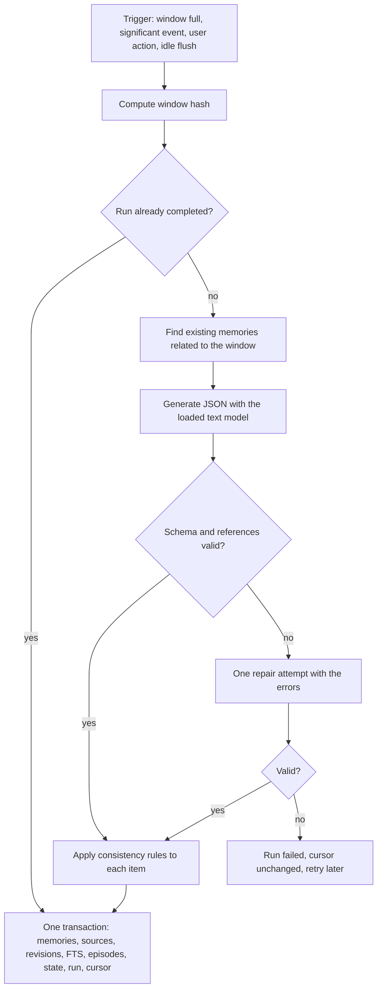

# Lyrveil Memory Engine

Status: accepted (2026-11-01), revised 2026-11-06 for the prompt layout. Implementation: partial, phase P04. Delivered in
P04.1: the memory tables of layers B to E, the `memory_fts` and `episode_fts` indexes, and the text preparation of
[Stemming](#stemming). Delivered in P04.2a: the extraction pipeline without the consistency rules
([Delivered in P04.2a](#delivered-in-p042a)). Delivered in P04.2b: the consistency rules without tombstones
([Delivered in P04.2b](#delivered-in-p042b)). Delivered in P04.2c: user edits with revisions and deletion with
tombstones ([Delivered in P04.2c](#delivered-in-p042c)). Delivered in P04.3: `FtsMemoryRetriever` with its scoring and
selection ([Delivered in P04.3](#delivered-in-p043)). Delivered in P04.4 and P04.5: summaries and the context builder.
Delivered in P04.7: invalidation after message changes and re-evaluation
([Delivered in P04.7](#delivered-in-p047)). Everything else is planned.

The engine keeps what a character should remember. It lives in SQLite and never depends
on a model staying in the GPU, so memory survives restarts, model switches and very long
conversations.

## Memory layers

| Layer | Content | Storage | Changed by |
| --- | --- | --- | --- |
| A. Identity | Canonical definition | `characters`, `character_traits`, `character_visual_profiles`, `character_versions` | The user only |
| B. Shared | Facts valid across chats of one character | `memories` with `scope = shared` | The user only, with "Condividi" |
| C. Conversation | Facts learned in one chat | `memories` with `scope = conversation` | Extraction, the user |
| D. Episodic | Significant events | `episodic_memories`, `episodic_sources`, `episode_links` | Extraction, the user |
| E. Relationship | How the relationship developed | `relationship_states`, `character_state_history` | `CharacterStateManager` |
| F. Working | Context of the current message | Rebuilt per message. Trace in `prompt_assemblies` | `ContextBuilder` |

Full history stays in `messages` and `message_variants`. Structured memory holds only
what is useful.

### Shared memory

Sharing is opt-in on both sides:

- A conversation reads shared memories only when `shares_memory = 1`. The default is 0.
- A memory enters the shared scope only through the user's "Condividi" action, which
  copies it and sets `origin_conversation_id`.
- Extraction never writes to the shared scope.

## The memory record

| Requirement | Representation |
| --- | --- |
| Stated fact | `provenance = stated` |
| Model inference | `provenance = inferred`, confidence at most 0.6 |
| Fictional narrative element | `provenance = fictional` |
| Temporary information | `durability = temporary`, `expires_at` set |
| Contradicted information | `status = contradicted`, `superseded` or `uncertain` |
| Confirmed by the user | `provenance = user_confirmed`, confidence 1.0 |

The columns are in [Data model](data-model.md#memories). Status meanings:

| Status | Used in prompts | Meaning |
| --- | --- | --- |
| `active` | Yes | Currently valid according to its provenance. |
| `uncertain` | Yes, labeled uncertain | Part of an unresolved conflict. |
| `superseded` | Only when the user asks about the past | A newer fact replaced it. |
| `contradicted` | No | Disproved with no replacement. |
| `expired` | No | Past its `expires_at`. |
| `invalidated` | No | Its sources were edited or deleted. Awaits re-evaluation. |

Confidence comes from the model as `low`, `medium` or `high` and is stored as 0.4, 0.7 or
0.95, then capped by the provenance rules.

## Extraction pipeline



### Triggers

| Trigger | Condition |
| --- | --- |
| Window | `memory.extract_every_messages` unprocessed messages. Default 10, allowed 8 to 12. |
| Significant event | The user message matches `prompts/it/significant_patterns.txt` and at least 2 messages are unprocessed. Examples: `ricordati`, `non dimenticare`, `ho cambiato`, `mi sono trasferit`, `ti prometto`, `ho deciso`. |
| User action | "Ricorda questo" on a message. |
| Idle flush | The conversation is idle for 15 minutes with at least 4 unprocessed messages. |
| Re-evaluation | A source message changed. See [Invalidation](#invalidation-after-message-changes). |

Extraction uses the already loaded model. Its jobs are eligible only in `LLM_READY`, never
cause a mode change and yield to any foreground job
([scheduling](gpu-orchestration.md#scheduling-rules)).

### Window

- From `last_extracted_seq + 1` to the newest complete message, at most 12 messages.
- The 2 previous messages are added as read-only context.
- `window_hash` covers the identifier and content hash of each active variant.

### Idempotency and failure

- `memory_extraction_runs` is unique on window hash, prompt version and schema version. A
  completed run is never repeated, except by a re-evaluation queued after it
  ([Delivered in P04.7](#delivered-in-p047)).
- Memory writes and the advance of `last_extracted_seq` share one transaction.
- A failure changes no memory and no cursor. Messages are never touched. The job retries
  after 1, 5 and 30 minutes.
- `raw_output` stays local for debugging and is removed after 30 days.

### Output schema

The grammar and the validator derive from these models. See
[ADR 0013](decisions/0013-structured-output-grammar-and-validation.md).

```python
class ExtractedMemory(BaseModel):
    relation: Literal["new", "duplicate", "update", "contradiction", "temporary", "correction"]
    target_ref: str | None = None          # "E3": an existing memory shown in the prompt
    kind: MemoryKind
    content: Annotated[str, StringConstraints(min_length=3, max_length=280)]
    subject: str | None = None             # "user.employer"
    value: str | None = None               # "Studio Rossi"
    provenance: Literal["stated", "inferred", "fictional"]
    durability: Literal["lasting", "temporary"]
    valid_until: date | None = None
    importance: Annotated[int, Field(ge=1, le=5)]
    confidence: Literal["low", "medium", "high"]
    source_seqs: Annotated[list[int], Field(min_length=1, max_length=8)]


class ExtractedEpisode(BaseModel):
    title: Annotated[str, StringConstraints(min_length=3, max_length=120)]
    description: Annotated[str, StringConstraints(min_length=3, max_length=600)]
    participants: list[str]
    importance: Annotated[int, Field(ge=1, le=5)]
    source_seqs: Annotated[list[int], Field(min_length=1, max_length=12)]
    linked_episode_refs: list[str] = []    # "P1": a recent episode shown in the prompt


class RelationshipEvent(BaseModel):
    dimension: Literal["familiarity", "trust", "confidence", "tension"]
    direction: Literal["up", "down"]
    magnitude: Literal["small", "medium", "large"]
    reason: Annotated[str, StringConstraints(min_length=3, max_length=200)]
    source_seqs: Annotated[list[int], Field(min_length=1, max_length=6)]


class StateUpdate(BaseModel):
    emotional_state: str | None = None
    current_topic: str | None = None
    open_threads_add: list[str] = []
    open_threads_close: list[str] = []
    goals: list[str] = []
    narrative_change: str | None = None


class ExtractionResult(BaseModel):
    schema_version: Literal[1]
    memories: Annotated[list[ExtractedMemory], Field(max_length=12)]
    episodes: Annotated[list[ExtractedEpisode], Field(max_length=3)]
    relationship_events: Annotated[list[RelationshipEvent], Field(max_length=4)]
    state: StateUpdate
```

The prompt shows existing memories as `E1..En` and recent episodes as `P1..Pn`. The service
maps these labels to real identifiers. A reference to an unknown label, or a `source_seqs`
value outside the window, drops that item and increments a counter.

### Delivered in P04.2a

`MemoryExtractionService` (`services/memory_extraction.py`) is the `memory_extraction` handler. The output schema is
`lyrveil/domain/memory_extraction.py`, exactly as above, with `SCHEMA_VERSION = "1"`; the prompt is
`lyrveil/prompts/extraction.py`, version `extraction.v1` ([Extraction template](prompting.md#extraction-template)).
Windows and triggers are `lyrveil/memory/window.py`, the SQL is `lyrveil/persistence/memory_extraction.py`.

- **Triggers.** Two of the five: the window and the significant event. They are checked after each reply is stored
  complete or interrupted, in a transaction of their own, and queue a `memory_extraction` job only when no extraction
  job of the conversation is queued or running. "Unprocessed" counts the messages a window would read (below). The
  threshold is `ExtractionSettings.every_messages`, default 10, refused outside 8 to 12; it is a constructor value
  until the settings store exists. The patterns are `backend/src/lyrveil/prompts/it/significant_patterns.txt`: a phrase
  matches at the start of a word of the text with case, accents and runs of spaces ignored, and may end inside a word.
  Only Italian has a list, so other languages have the window trigger only. "Ricorda questo" and the idle flush are not
  delivered; re-evaluation came with P04.7 ([Delivered in P04.7](#delivered-in-p047)).
- **Window.** The messages after `last_extracted_seq`, in order, up to the first reply still `queued` or `streaming`.
  Deleted, failed, empty and system messages are passed over; the first 12 others form the window, from the cursor plus
  one to the last of them. The 2 readable messages before it are the context. `window_hash` is the SHA-256 of message
  id, active variant id and content hash of each window message. Each message is one line in the prompt, cut at 1200
  characters, so a line break cannot start a fake numbered message and long messages cannot push the rules out.
- **Shown memories.** Up to 12 active or uncertain memories of the conversation: those that share a stem with the
  window (the first 64 distinct stems, ranked by bm25), then the most recently changed. Up to 5 recent active episodes.
  Shared memories are not shown.
- **Idempotency.** A run row is written `running` before generation, or an existing `failed`, `superseded` or
  interrupted `running` row is restarted with `attempt + 1`. A window whose run is `completed` is not generated again:
  the cursor moves past it and the job ends `already_extracted`. A job run again after its commit finds the next window
  or nothing. The commit transaction reads the window again; if the cursor moved or a message of the window changed
  while the model ran, the run becomes `superseded`, nothing is written and the trigger is checked again. Otherwise it
  writes the items, the run `completed` with `raw_output`, and the cursor, then checks the trigger for what is left.
- **Failure.** Output refused twice records the run `failed` with `STRUCTURED_OUTPUT_INVALID` and the last refused text
  in `raw_output`, and the job retries after 1 and 5 minutes ([Retry policy](backend.md#retry-policy)). A runtime
  failure records its code the same way. Neither touches memories, messages or the cursor. The 30-day removal of
  `raw_output` is not delivered.
- **Applied items.** `new` and `temporary` insert an active conversation memory with its sources and `memory_fts` row,
  unless an active or uncertain memory of the conversation has the same fingerprint, which is then treated as the
  `duplicate`. A `duplicate` adds its sources and raises the importance, with no new version; a locked target gets
  the sources only. Confidence is stored as in [the memory record](#the-memory-record), an inference capped at 0.6.
  `valid_from` is the creation time of the newest source. A temporary memory expires at the end of `valid_until` (UTC),
  or 7 days after the run when the date is missing or past. `subject` becomes a key of lowercase letters, digits, `.`
  and `_`. Episodes are inserted with their sources and `episode_fts` row, or add their sources to an active episode
  with the same fingerprint; `linked_episode_refs` become `related` links.
- **Not applied yet.** `update`, `contradiction` and `correction` items, and the guards of
  [Consistency rules](#consistency-rules), were P04.2b ([Delivered in P04.2b](#delivered-in-p042b)); relationship
  events and the state update came with P04.6 ([Delivered in P04.6](consistency-engine.md#delivered-in-p046)). Valid
  ones were counted as `deferred_items` in the job's result and not stored, so a window extracted before those tasks
  does not get them later. An item with an unknown label, a missing
  target, a source outside the window or blank text is counted in `dropped_items`.
- **Fingerprint.** `lyrveil.memory.text.fingerprint`: the SHA-256 of the distinct stems, sorted. Repeated words count
  once. A text made only of stop words falls back to its distinct normalized words. Similarity deduplication came with
  P04.2b.

`tests/integration/test_memory_extraction.py` holds T-MEM-01 to T-MEM-03, the scheduler half of T-MEM-17 and the
trigger checks; `tests/unit/test_memory_extraction.py` holds the policy half of T-MEM-17 and the schema, grammar,
window, trigger and fingerprint checks ([Testing](testing.md#memory)).

### Consistency rules

`MemoryConsistencyService` applies these to each item before writing. The model only
proposes. These rules decide.

| Relation | Check | Action |
| --- | --- | --- |
| `new` | No active memory with the same fingerprint, no blocking tombstone | Insert. |
| `duplicate` | Target exists | Add sources. Raise importance to the higher value. Same fingerprint, no new version. |
| `update` | Target exists, same subject, source newer than the target's sources | Target becomes `superseded` with `valid_to` and `superseded_by_id`. New memory with `valid_from`. |
| `contradiction` | Target exists, and the change is unclear | Both become `uncertain` in one `conflict_group_id`. A `memory.conflict` event fires when importance is at least 3. |
| `temporary` | `valid_until`, or 7 days by default | Insert with `expires_at`. It never supersedes a lasting fact. |
| `correction` | A source message is by the user | Target becomes `superseded`. New memory with `provenance = user_confirmed`, confidence 1.0. |

Guards applied after the table:

1. **Provenance check.** A `stated` memory about the user needs a source message by the
   user. Otherwise it becomes `inferred`. A fact the character states about itself in the
   chat becomes `fictional`.
2. **Inference limit.** An inference never supersedes a stated or confirmed memory. A
   conflict places the inference in `uncertain`.
3. **Deterministic conflict.** Two active memories with the same single-valued `subject_key`
   and different values never coexist as active, whatever the model said. An explicit change
   cue, such as `ho cambiato` or `ora lavoro`, makes it an `update`. Otherwise it is a
   `contradiction`. The single-valued list is `user.name`, `user.age`, `user.city`,
   `user.employer`, `user.job`, `user.partner` and `user.birthday`.
4. **Lock.** A locked target is never changed. New information becomes `uncertain` with
   `needs_review`.
5. **Identity.** Information that would change canonical data is stored only with
   `kind = identity_candidate`. It never enters prompts. The Memory Studio offers
   "Applica al profilo", which creates a new character version after the user's review.
6. **Tombstone.** See below.

### Deduplication

The fingerprint is a SHA-256 of normalized content: lowercase, accents removed, punctuation
removed, stop words removed, stemmed, tokens sorted. Two memories of the same kind and
subject with a stem-set Jaccard similarity of at least 0.8 also count as duplicates.

### Deletion and tombstones

Deleting a memory removes its text. A tombstone keeps the fingerprint, subject key, value
hash, source hashes and newest source sequence.

A candidate is blocked when both hold:

- its fingerprint matches a tombstone, or its subject key and value hash match one;
- every source is at or before `source_max_seq`, or its content hash is listed in the
  tombstone.

A later message that states the same fact is new information, so the memory can return.

### Worked example: a job change

| Moment | Message | Result |
| --- | --- | --- |
| March | "Lavoro allo Studio Rossi." | `user.employer = Studio Rossi`, `stated`, `active`, source 112. |
| June | "Ho cambiato lavoro, ora sono da Verdi & Co." | Rossi becomes `superseded`, `valid_to` June. New `user.employer = Verdi & Co`, `active`, source 480. |
| June | Prompt | Shows only `[sicuro] Lavora da Verdi & Co.` |
| June | "Dove lavoravo prima?" | Past intent. Also shows `[passato] Lavorava allo Studio Rossi fino a giugno.` |
| July | "Non so se resto da Verdi o torno da Rossi." | Reported doubt. Both stay as they are, plus a `temporary` memory that the user is undecided. |

### Delivered in P04.2b

`MemoryConsistencyService` (`services/memory_consistency.py`) applies the rules above to each memory item in the
commit transaction of its run. The decision is the pure `decide` of `lyrveil/memory/consistency.py`; the service reads
its inputs and writes the result. The order for one item is: the provenance check, the effective relation,
deduplication, what the relation and guard 3 ask of each existing memory, then the lock and the inference limit.

- **Provenance check (guard 1).** A `stated` item of kind `user_fact` or `user_preference`, or with a `user.` subject,
  and no source message by the user becomes `inferred`, so its confidence is capped at 0.6. A `stated`
  `character_fact` with a source message by the character becomes `fictional`.
- **Effective relation.** `new` and `temporary` ignore `target_ref`. An `identity_candidate`, and a temporary item aimed
  at a lasting memory, are stored as new and never change the target. A `duplicate` whose single-valued subject has
  another value is new. A `correction` without a source message by the user is a contradiction. An `update` whose
  subject differs from the target's (both given) is new, and one whose newest source is not newer than the target's
  newest source is a contradiction.
- **Deduplication.** A memory in use (active or uncertain) of the conversation with the same fingerprint, of any kind,
  is the duplicate. Otherwise a memory of the same kind and subject (two empty subjects count as the same) whose
  distinct stems have a Jaccard similarity of at least 0.8, and whose value does not differ, is the duplicate. The
  candidates are the 16 best FTS matches of the item's first 32 stems. An update or correction never counts its own
  target, because negations such as `non` are stop words and leave the fingerprint unchanged; when that target stays in
  use after the guards, the item confirms it instead, since the unique fingerprint index allows only one of them. A
  duplicate adds its sources and raises the importance, with no new version; a locked one gets the sources only.
- **Changes.** `update` and `correction`: the target becomes `superseded`, with `valid_to` set to the new memory's
  `valid_from` and `superseded_by_id`, and keeps its sources; the new memory is `active`. A correction that supersedes
  is stored `user_confirmed` with confidence 1.0. `contradiction`: the target becomes `uncertain`, and the new memory is
  stored `uncertain` in the same `conflict_group_id` (an existing group of a member, or a new one).
- **Deterministic conflict (guard 3).** A lasting item with a value and a single-valued subject is compared with the
  other active lasting memories of that subject that have a value. One with a different value (compared by
  fingerprint, so `Verdi & Co` and `verdi e co.` agree) is superseded when a user source message holds a change cue of
  `backend/src/lyrveil/prompts/it/change_cues.txt`, matched like the significant patterns; otherwise it becomes
  uncertain with the item. Temporary memories and identity candidates are outside this guard, so "questa settimana è a
  Roma" sits next to "vive a Milano".
- **Inference limit (guard 2).** An `inferred` item, unless it is a correction, never supersedes or demotes a `stated`
  or `user_confirmed` memory: that memory keeps its status and joins the conflict group, and the inference is stored
  `uncertain`.
- **Lock (guard 4).** A locked memory is never changed, not even put in a group: the item is stored `uncertain` with
  `needs_review`.
- **Identity (guard 5).** `identity_candidate` memories are stored with their sources but never shown in a prompt,
  never targeted, and never change another memory or the character's card. Code relies on the model's label: a card
  change the model stores under another kind is not detected yet. "Applica al profilo" is the Memory Studio's, P04.9.
- **Revisions.** Every change to an existing memory first appends its whole row to `memory_revisions` under its current
  version, then moves it to the next `version`. `actor` is `extraction` and `run_id` the run; `reason` is `update`,
  `correction`, `contradiction`, `subject_change`, `subject_conflict` or `inference_conflict`. A duplicate writes no
  revision.
- **Expiry.** When a run starts, the conversation's temporary memories in use whose `expires_at` has passed become
  `expired`, each with a revision by `consistency` with reason `expired`. Lasting memories are never touched.
- **Prompt.** The extraction prompt is `extraction.v2` ([Extraction template](prompting.md#extraction-template)): it
  never shows an identity candidate, and shows an uncertain memory as `E2: [incerto] ...`. Since P04.6 it is
  `extraction.v3`, which also lists the open threads of the conversation state.
- **Event and result.** After a committed run, `memory.conflict` with `memory_id` and `conversation_id` is published for
  each new memory stored `uncertain` when the highest importance among it and the memories it conflicts with is at
  least 3. The job's result adds `memories_superseded`, `memories_uncertain` and `conflict_ids`, and `deferred_items`
  now counts only relationship events. Since P04.6 relationship events are applied, `state_events` counts the state
  rows a run wrote, and `deferred_items` counts only a proposed `current_topic`.
- **Not delivered.** `POST /memories/{id}/resolve`; the Memory Studio shows a contradiction since P04.9a; the labels of the
  reply prompt, which needs retrieval and the context builder (P04.3, P04.5). Invalidation came with P04.7. Only Italian has
  change cues, so in another language a changed single-valued value always becomes a contradiction. Tombstones came
  with P04.2c.

`tests/unit/test_memory_consistency.py` holds T-MEM-04, T-MEM-14 and the other rules of `decide`;
`tests/integration/test_memory_extraction.py` holds T-MEM-10 to T-MEM-13 and the extraction half of T-CON-05
([Testing](testing.md#memory)).

### Delivered in P04.2c

User edits and deletions (`MemoryService`, `services/memories.py`) and guard 6 in `MemoryConsistencyService.apply`.

- **Edit.** Changes the text, subject, value or importance (text 1 to 280 characters, importance 1 to 5). The whole row
  as it was goes to `memory_revisions` with `actor = user`, `reason = edit` and no run; the memory moves to the next
  version, its fingerprint follows the new text and its index row is refreshed. Status, provenance, confidence, lock and
  sources are kept: a locked memory can be edited, since the lock only stops automation. An edit that alters nothing
  writes nothing. A new text equal to another memory in use of the same owner is refused with `ConflictError`.
- **Delete.** One transaction adds the tombstone and removes the memory row, its revisions, sources and index row. The
  tombstone keeps the fingerprint, subject key, the fingerprint of the value as `value_hash`, the sorted content hashes
  of the sources and the seq of the newest source; no text. A memory with no source takes the conversation's cursor (at
  least 1), so no message already read can bring it back. A memory it had superseded stays superseded and loses the link.
- **Guard 6.** Runs after `decide`, so only an item that would store a new memory can be blocked; an item that repeats a
  memory in use is a duplicate and adds its sources. The tombstones read are those of the same character and
  conversation with the candidate's fingerprint, or with its subject key and value hash. The item is blocked when every
  source is at or before `source_max_seq`, or has a content hash the tombstone lists (`consistency.is_blocked`); a
  single source that is newer and has new content lets it through. A blocked item writes nothing and is counted in
  `blocked_items` of the job result; nothing else is returned to the model.
- **Not delivered.** Tombstones for shared memories (the scope is not written yet), and tombstones for
  episodes. A window never holds a message at or before the cursor, so in the running pipeline a block shows up
  when the model restates a deleted fact from a message with the same content, or when a re-evaluation (P04.7)
  analyzes old messages again; the same-source case is covered by calling `apply` directly.

`tests/integration/test_memory_extraction.py` holds T-MEM-08 and T-MEM-09 and `tests/unit/test_memory_consistency.py`
the pure `is_blocked` ([Testing](testing.md#memory)).

## Retrieval

### Stemming

FTS5 has no Italian stemmer, so Python prepares the text:

1. Normalize with NFKC and lowercase, and remove accents.
2. Split into word tokens with the `[^\W_]+` pattern (letters and digits).
3. Remove stop words, from a list stored per language in the repository.
4. Stem with `snowballstemmer`: `italian`, `english`, `french`, `german`, `spanish`.

The indexed column stores the stems. The tokenizer `unicode61 remove_diacritics 2` handles
accents in the index too. Queries use the same steps. Each stem is quoted and joined with `OR`, so raw user
text never reaches FTS query syntax. Unknown languages skip the stop-word and stemming steps.

Delivered in P04.1 (`lyrveil.memory.text`):

- Accents are folded in step 1, before stemming, so `perché` and `perche` give the same stem even where a stemmer
  would treat the two spellings differently. The stop-word files are folded the same way when read.
- The language is the primary subtag of the memory's tag (`it-IT` gives `it`). The lists are
  `backend/src/lyrveil/memory/stopwords/<code>.txt` for `it`, `en`, `fr`, `de` and `es`: one word per line, `#`
  comments, elided forms such as `dell` or `l` without the apostrophe. They are a starting point: P04.10 tunes them
  against the retrieval evaluation.
- `match_query(text, language)` returns the quoted, distinct stems joined with `OR`, or `None` when no word is left.
  Words such as `AND`, `NOT`, `NEAR`, a column filter (`content_stem:x`), a star or a quote become plain words.
- Tests: `tests/unit/test_memory_text.py` covers T-MEM-06 and T-MEM-07 against a real in-memory FTS5 table, and
  `tests/integration/test_memory_index.py` the index rows of a migrated database.

### Retrieval contract

The brief's `retrieveRelevantMemories` is `retrieve_relevant_memories` in Python, following
PEP 8. `FtsMemoryRetriever` is the 1.0 implementation.

```python
@dataclass(frozen=True)
class RetrievalQuery:
    character_id: str
    conversation_id: str
    text: str                       # Latest user message and the two turns before it
    topic: str | None
    language: str
    token_budget: int
    now: datetime
    include_shared: bool            # conversations.shares_memory
    past_intent: bool               # The user is asking about the past
    previous_ids: frozenset[str]    # Selection used for the previous reply
    max_items: int = 24


class MemoryRetriever(Protocol):
    def retrieve_relevant_memories(self, query: RetrievalQuery) -> RetrievalResult:
        """Return the best memories and episodes that fit `token_budget`.

        Results always belong to `character_id`, and to `conversation_id` or, when
        `include_shared` is true, to the shared scope. Each item holds its score parts
        for diagnostics. An empty result is valid. Raises only on a database failure.
        """
```

A semantic or hybrid retriever implements the same Protocol. No caller changes.

### Candidates

SQL filters always apply, before any ranking:

- `character_id` matches;
- `conversation_id` matches, or `scope = shared` when `include_shared` is true;
- `status IN ('active', 'uncertain')`, plus `superseded` when `past_intent` is true;
- not expired;
- `kind <> 'identity_candidate'`.

Candidates come from two routes: up to 64 FTS matches, and up to 16 standing memories that
apply regardless of the words used (locked memories, importance 5, `boundary`, and active
`promise` and `open_thread` kinds).

### Scoring

```text
score = 0.40 fts + 0.20 importance + 0.15 recency + 0.10 topic + 0.10 kind + 0.05 confidence
score = score × status_factor
score = min(1, score + 0.10 if locked + 0.05 if in previous_ids)
```

| Part | Formula |
| --- | --- |
| `fts` | 0 without a match. With a match, `0.5 + 0.5 × (s - s_min) / (s_max - s_min)`, where `s = -bm25(memory_fts, 0.0, 2.0, 1.0)` over this candidate set (one weight per column, including the unindexed identifier), and 1.0 when all are equal. BM25 gives near-zero values on small tables, so absolute values cannot be used. |
| `importance` | `(importance - 1) / 4` |
| `recency` | `exp(-ln2 × age_days / 30)` on `updated_at`. Floor 0.5 for locked memories and importance 5. |
| `topic` | Share of the current topic's stems found in the memory. |
| `kind` | `boundary` 1.0, `promise` 0.9, `open_thread` 0.9, `user_preference` 0.8, `user_fact` 0.8, `decision` 0.7, `narrative_event` 0.6, `character_fact` 0.6 |
| `confidence` | The stored value. |
| `status_factor` | `active` 1.0, `uncertain` 0.8, `superseded` 0.7 |

All weights are settings (`memory.retrieval.*`). The bonus for `previous_ids` keeps the
selection stable between turns, which keeps the prompt prefix stable and the reply fast.

### Selection

1. Sort by score, highest first.
2. For one subject keep the best memory. Members of one conflict group stay together.
3. Allow at most 6 items per kind and 3 episodes.
4. Add items while their token cost fits the budget, up to `max_items`.
5. Update `last_used_at` and `use_count` after the reply is committed.

### Past intent

`past_intent` is true when the latest user message matches a cue list stored per language.
Italian examples: `prima`, `una volta`, `l'anno scorso`, `ai tempi`, `ti ricordi quando`,
and imperfect forms with `lavoravo` or `abitavo`.

### Prompt rendering

```text
Ricordi pertinenti:
- [sicuro] Lavora da Verdi & Co. da giugno.
- [incerto] Forse ha un fratello di nome Luca.
- [storia] Avete trovato una mappa nascosta al porto vecchio.
- [per ora] Questa settimana dorme da sua sorella.
- [passato] Lavorava allo Studio Rossi fino a giugno.
- [episodio] La notte al faro: siete rimasti svegli a parlare del suo trasloco.
```

| Label | Applied to |
| --- | --- |
| `[sicuro]` | `stated` or `user_confirmed`, `active` |
| `[incerto]` | `inferred`, or `uncertain` status |
| `[storia]` | `fictional` |
| `[per ora]` | `temporary` |
| `[passato]` | `superseded` under past intent |
| `[episodio]` | Episodes |

### Delivered in P04.3

The contract is `ports/memory_retriever.py` (`RetrievalQuery`, `RetrievalResult`, `RetrievedMemory`, `ScoreParts`,
`MemoryRetriever`). `FtsMemoryRetriever` is `services/memory_retrieval.py`, over the SQL of
`persistence/memory_retrieval.py` and the pure rules of `memory/retrieval.py`.

- **Scope.** Every candidate query filters in SQL by character, then by conversation, or by `scope = shared` when
  `include_shared` is true **and** the conversation belongs to the character with `shares_memory = 1`, so a wrong flag
  alone reads nothing shared. Statuses, expiry (`expires_at` after `now`) and `identity_candidate` are filtered in the
  same query. Episodes have no shared scope and are read only for their own conversation.
- **Candidates.** Up to 64 FTS matches of the query's stems (at most 48 distinct stems), up to 16 standing memories, the
  other uncertain members of any conflict group a candidate belongs to, and up to 16 matching active episodes. A query
  with no searchable word gets the standing memories only.
- **Scoring** as in the table above, with the weights normalized to a sum of 1. BM25 is normalized separately for
  memories and episodes, since they come from two indexes. Not in the table and decided here: an episode scores kind
  0.6 (like `narrative_event`), confidence 1.0 and status factor 1.0, and its content is `title: description`; `topic`
  compares the stems of the topic with those of the text and subject key; a future `updated_at` counts as age 0.
- **Selection.** Ties go to memories, then to the identifier. A superseded memory under past intent does not compete
  with the memory in use of its subject, so `[passato]` can stand beside the current fact. A conflict group enters
  whole or not at all. A unit that does not fit the budget, `max_items` or a cap per kind is skipped, and smaller ones
  after it can still enter. The budget covers the item lines, not the block header, which is the context builder's.
- **Token cost.** Each line `- <label> <content>` is priced by an injected function. The default,
  `estimate_tokens`, is one token per three characters plus one, rounded up: it only packs the block, and the final
  prompt is still counted by the runtime and reduced from the lowest scores ([Token counting](#token-counting)).
- **Past intent.** `is_past_intent` in `memory/retrieval.py` reads `prompts/it/past_cues.txt`; other languages have no list
  yet, so they never have past intent.
- **Use counters.** `FtsMemoryRetriever.record_use` sets `last_used_at` and adds 1 to `use_count`, leaving `updated_at`
  alone, so use does not count as recency. Since P04.5 `ChatInferenceService` calls it after each reply is announced.
- **Not delivered.** The `memory.retrieval.*` settings as user settings (the weights are a `RetrievalWeights` argument
  for now), and past-intent cues outside Italian. Since P04.5 replies call the retriever and render block 5
  ([Delivered in P04.5](#delivered-in-p045)).

`tests/integration/test_memory_retrieval.py` holds T-MEM-05, T-MEM-15, T-CON-01, T-CON-02 and T-MEM-22;
`tests/unit/test_memory_retrieval.py` the pure rules ([Testing](testing.md#memory)).

## Contradictions

| Situation | Recognized as | Result |
| --- | --- | --- |
| Nothing similar exists | New information | Insert |
| Same fact, same value | Duplicate | More sources |
| A later message changes a single-valued fact | Update | History kept, new version in use |
| Values conflict, with no clear change | Contradiction | Both uncertain, shown as uncertain |
| "Questa settimana sono a Roma" | Temporary | Expires, and the lasting fact stays |
| "No, non ho detto questo: ho due gatti" | User correction | Previous memory superseded, new one confirmed |

The Memory Studio lists conflicts. `POST /memories/{id}/resolve` keeps the chosen memory and
marks the others `contradicted`, with a revision for each. History is never silently
removed, and source references stay in place.

## Progressive summaries

Each checkpoint covers a message range. Originals are never replaced.

| Rule | Value |
| --- | --- |
| Recent tail excluded from summaries | The newest 30 messages |
| Level 0 chunk | 40 messages, or at least 2400 tokens |
| Rollup | When 6 consecutive checkpoints of one level exist, the oldest 4 become one checkpoint of the next level. Their rows stay. |
| Eligibility | `LLM_READY` only, never in image mode, never causes a mode change |
| Cursor | `last_summarized_seq` advances with the checkpoint in one transaction |

Output:

```python
class SummaryResult(BaseModel):
    schema_version: Literal[1]
    text: Annotated[str, StringConstraints(max_length=1600)]
    events: list[str]
    decisions: list[str]
    relationship_changes: list[str]
    unresolved: list[str]
    key_facts: list[str]
    source_seqs: list[int]
```

Re-summarizing a range creates a new version and marks the old one `superseded`.

### Choosing summaries for a prompt

The budget is `context.summary_target_tokens`. The builder takes:

1. The newest checkpoint immediately before the recent messages.
2. Earlier checkpoints, walking backward, while they fit and the coverage stays contiguous.
3. When room remains and an older range is uncovered, the highest-level rollup of up to 200
   tokens.

`invalidated` checkpoints are never used. A gap in coverage is allowed and is logged in the
prompt assembly.

### Delivered in P04.4

`SummaryService` (`services/summaries.py`) is the `summary_checkpoint` handler. The output schema is
`lyrveil/domain/summaries.py` (`SummaryResult` as above, with `text` of 3 to 1600 characters and at most 8 entries of 3
to 200 characters per list); the prompts are `lyrveil/prompts/summary.py`, version `summary.v1`, at temperature 0.3 and
`max_length` 700 ([Structured tasks](prompting.md#structured-tasks)). The pure rules are `lyrveil/memory/summaries.py`,
the SQL `lyrveil/persistence/summaries.py`, the table `conversation_summaries`
([Data model](data-model.md#conversation_summaries)).

- **Triggers.** After each reply is stored, in the transaction that also checks the extraction trigger, and after each
  finished run. A `summary_checkpoint` job is queued when a chunk or a rollup is due and no summary job of the chat is
  queued or running. The job needs `llm` and is background work, so it waits in image mode and with no runtime ready,
  and never causes a mode change.
- **Chunk.** The readable messages after `last_summarized_seq`, up to the first reply still pending, leaving out the
  newest `summary.recent_tail_messages` (30) readable messages of the chat. A chunk takes the first
  `summary.chunk_messages` (40) of them, or fewer when their cost reaches 2400 tokens first; with neither reached,
  nothing is due. Cost is `estimate_tokens` of each message, a high estimate. The range runs from the cursor plus one to
  the last message taken, so passed-over messages (deleted, failed, empty, system) fall inside it and consecutive
  chunks are contiguous. The cursor moves to the end of the range in the transaction that stores the checkpoint.
  Both settings are constructor values (`SummarySettings`, refused outside 20 to 100 and 10 to 100) until the settings
  store exists.
- **Rollup.** At each level, the active checkpoints that start after the end of the newest active checkpoint of the next
  level form runs of contiguous ranges. The first run of at least 6 gives its oldest 4 to the model, which writes one
  checkpoint of the next level over their whole range. The merged rows stay as they are and `active`. Six level-1
  rollups merge into one of level 2 the same way.
- **Versions.** A job whose payload is `{"from_seq", "to_seq"}` summarizes that level-0 range again: the new row takes the
  next `version`, the active row of the range becomes `superseded`, and the cursor stays. A checkpoint is never
  overwritten: a trigger of the table refuses an UPDATE of anything but `status`. Rollups over a range that is
  summarized again are not recomputed.
- **Idempotency.** The commit reads the covered messages (or the checkpoints to merge) again. If the cursor moved, a
  message of the range changed (`source_hash` is the hash of message id, active variant id and content hash) or the
  rollup due is no longer the same, nothing is written and the job ends `superseded`, after the trigger is checked again.
  Invalid output refused twice fails the job with `STRUCTURED_OUTPUT_INVALID`, retried after 1 and 5 minutes
  ([Retry policy](backend.md#retry-policy)); a runtime failure goes through for the scheduler to retry. Neither writes
  anything or touches the cursor.
- **Stored.** `text`, the lists of `SummaryResult` and `source_seqs` (the cited messages inside the range, ascending;
  others are dropped) in `content_json`, `source_hash`, `prompt_version` and `token_count`, counted by the runtime
  tokenizer.
- **Choosing summaries.** `choose_summaries` implements the three steps above: the newest level-0 checkpoint before the
  recent messages, earlier ones while each ends right before the one after and fits the budget, then the active
  rollup of the highest level that ends before all of them and costs at most 200 tokens. It returns the gaps in
  coverage for the prompt assembly to log. Since P04.5 every reply prompt calls it, through `active_summaries`.
- **Not delivered.** The `summary.*` settings as user settings. Rollups are built from the checkpoints' text and lists,
  not the original messages. Since P04.7 an edited or deleted covered message invalidates its checkpoints and queues the
  range again ([Delivered in P04.7](#delivered-in-p047)).

`tests/integration/test_summaries.py` holds T-MEM-16 and the scheduler half of T-MEM-17; `tests/unit/test_summaries.py`
the policy half of T-MEM-17 and the pure rules ([Testing](testing.md#memory)).

## Context composition

`ContextBuilder` builds the blocks below. `PromptFormatter` places them in four parts, from most to
least stable ([ADR 0031](decisions/0031-stable-prefix-dynamic-context-and-anchor.md)):

1. **Stable system text**: blocks 1, 2, 3 and 6.
2. **History**: block 7, as plain turns.
3. **Dynamic context**: blocks 4, 5 and 9, in a fixed frame inside the last user turn.
4. **Current message**: block 8.

| # | Block | Part | Priority when over budget | Min | Target | Max |
| --- | --- | --- | --- | --- | --- | --- |
| 1 | Global instructions | Stable | Never reduced | 250 | 350 | 450 |
| 2 | Canonical identity | Stable | Required fields never reduced | 250 | 700 | 900 |
| 3 | Communication profile | Stable | Examples cut first | 80 | 350 | 500 |
| 4 | Conversation state and time | Dynamic | Details reduced late | 60 | 200 | 300 |
| 5 | Relevant memories | Dynamic | Lowest scores cut | 0 | 900 | 1400 |
| 6 | Contextual summary | Stable | Older parts cut | 0 | 600 | 900 |
| 7 | Recent messages | History | Oldest cut, floor 800 | 800 | Remainder | Remainder |
| 8 | Current message | Current | Never reduced in normal use | Actual | Actual | 2048 |
| 9 | Anchor | Dynamic | Never reduced | 60 | 110 | 160 |
| - | Reserved for the reply | | The band's `max_length`, see [Length bands](prompting.md#length-bands) | 60 | | 400 |
| - | Safety margin | | Fixed | | 64 | |

With a window of 8192, the targets of blocks 1 to 6 and 9 total 3210 tokens. The reply, at most
400, and the margin take up to 464, so about 4500 tokens remain for messages.

### Algorithm

```text
limit = true context size reported by the runtime
reply_reserve = max_length of the character's length band
available = limit - reply_reserve - safety_margin
render blocks 1, 2 (required), 3 (core), 8, 9; count tokens
allocate block 4 at target
query memories with budget = target of block 5
choose summaries with budget = target of block 6
fill block 7 from newest to oldest with everything left
if block 7 ended before the oldest message would be needed:
    give spare tokens to memories, then summary, up to their max
assemble and count the full prompt with the runtime
while total > available (at most 3 rounds):
    apply the next reduction
record the assembly, send the prompt
```

Reduction order: message examples, oldest summary parts, lowest-scoring memories, oldest
recent messages down to the floor, optional identity fields not locked (interests,
background details), state details.

Never removed: global instructions, first name, age, grammatical gender, narrative identity,
main traits, values, the core style description, the anchor and the current message. A current message over 2048 tokens is
truncated in the prompt only, with a visible note in the interface. The API limit of 8000
characters keeps this rare.

### Token counting

- `POST /api/extra/tokencount` is the authority.
- `messages.token_count` caches per message, with `tokenizer_id`. A model change recounts.
- Blocks are cached in memory by content hash.
- The final prompt is always counted as a whole, with `special: true`.
- A length estimate may only choose how many messages to count next. It never decides that
  a prompt fits.

### Prefix stability

KoboldCpp reuses the cached part of the prompt up to the first changed token. To keep that part long:

- Everything that changes on most turns (state, time, memories and the anchor) is placed after the
  history, in the last user turn. Old turns are rendered without it, so the stable text and the history
  stay byte-identical between replies ([ADR 0031](decisions/0031-stable-prefix-dynamic-context-and-anchor.md)).
- The summary changes only at a checkpoint, so it stays in the stable text.
- Time context uses coarse values such as "stasera" and "tre giorni fa".
- The bonus for `previous_ids` avoids needless memory churn.
- State changes only after extraction.

`test_the_stable_prefix_stays_byte_identical_across_a_scripted_conversation` (P08.4, in
`backend/tests/unit/test_context_builder.py`) checks the first point over twelve replies of one chat for each template
family. Memories, notes and the clock change at every turn, and the test asserts that the prefix of each reply starts
with the bytes of the one before and that the changing text sits after the prefix. It prints the prefix size of every
reply and records it as the `prefix_stability` property. The text it checks is the prompt text, not the cache itself:
KoboldCpp's reuse is measured through `last_process` (R-10). The test does not cover a history that outgrows the
context window, where the budget decides what the prompt keeps.

A reply therefore reprocesses the previous exchange and the new dynamic context, about 1,000 to 2,500
tokens. Gemma 4 profiles keep a sliding-window cache, so KoboldCpp also replays up to 2,048 cached tokens
when the reuse point lies beyond that cache. SWA padding and SmartCache are measured levers for this
([Runtime contracts](runtime-contracts.md#flags)).

P04 measures the prompt processing time with `last_process` from `/api/extra/perf`, for this layout and
for a single system text.

### Delivered in P04.5

`ContextBuilder` is `lyrveil/context/builder.py`, the block texts `lyrveil/context/blocks.py`, the token counts
`lyrveil/context/tokens.py`. `ChatInferenceService` loads its input with `load_context_request` and sends what it returns
([Backend](backend.md#streaming-persistence)).

- **Window and reserve.** The limit is `max_context_length` from the runtime's `info`. The reply reserve, and the
  request's `max_length`, is the band's value capped by `llm.max_length` ([Length bands](prompting.md#length-bands));
  `available` also leaves `context.safety_margin_tokens`. `context.reply_reserve_tokens` is not read: the algorithm
  and [Configuration](configuration.md) both tie the reserve to the band, so whether that key stays is open.
- **Counts.** Every count that decides comes from `count_tokens`. `TokenCounter` caches counts in memory by the SHA-256
  of the text and the model name, so a model change counts again; at most 8192 counts are kept. A history turn is
  priced as its text plus the markers of the family, measured once per model on a fixed probe of two turns, plus one
  token; that price only chooses how many messages to try. The whole prompt is counted with `special: true` after the
  fill and after each round of reductions, and `token_total` is that count. `messages.token_count` is not written:
  the in-memory cache replaces it until a restart.
- **Order.** Block 1, block 2 in full, block 3 with its examples in saved order up to the first that would take it
  over 500 tokens, block 4, the anchor, and block 8 cut to 2048 tokens when longer (the start is kept, the stored
  message is not changed, and the interface note is not delivered). Then memories with `context.memory_target_tokens`
  and summaries with `context.summary_target_tokens`. The history candidates are the messages after the newest active
  checkpoint; they fill what is left from the newest back and stop at the first that does not fit, so the history
  stays contiguous, and never get less than the 800-token floor. When every candidate fits, the room left widens the
  memory query, then the summary budget, up to 1400 and 900.
- **Summaries.** `choose_summaries` runs with the first history seq; since every checkpoint ends before the
  candidates, the choice does not depend on how far back the history reaches. The gaps between the chosen checkpoints
  and the history are returned as `Assembly.gaps`.
- **Over budget.** When the history was cut by the room left and the count still exceeds `available`, the oldest
  turns go first, down to the floor, so a small miss of the turn prices never changes the stable text. Then, for at
  most 3 rounds in all, the reductions apply in order, each until spent before the next starts, until the runtime
  counts of what they removed cover the excess: the examples from the last, the oldest checkpoints, the lowest memories
  (a conflict group whole), the oldest turns down to the floor, the optional identity parts, the state details. One
  step is added after the documented list: turns below the floor, oldest first, because a prompt longer than the window
  would lose its start, the global instructions, inside the runtime. A prompt still over is sent and logged as
  `context_over_budget`.
- **Identity parts.** Block 2 never loses the name, age, gender, narrative identity, main traits and values. The
  optional parts go in this order: interests, background, the unlocked traits of relational style, temperament,
  humor, habits, fears, flaws, preferences and motivations, then biography, setting and occupation. A locked trait of any
  category stays.
- **Retrieval.** The query is the current message and the two turns before it, with past intent from the Italian cue
  list, the conversation's `shares_memory`, and the previous reply's selection as `previous_ids`, kept in memory per
  chat by `ChatInferenceService` (a restart loses only that bonus). The retriever runs in a worker thread. Use counters
  are recorded after the reply is announced.
- **Record.** `Assembly` holds the prompt, `max_length`, the limit, `available`, `token_total`, the runtime count of
  each block, the example count, the memories with their score parts, the summary ids, the gaps, the history seqs, the
  reductions applied and whether the current message was cut. The reply logs it as `context_assembled`, with counts
  only. Since P04.9b the reply also stores it in `prompt_assemblies` ([Delivered in P04.9b](#delivered-in-p049b)).
- **Not delivered.** Block 4: no state existed before the Character State Manager and no time context exists before
  P07.4, so `StateText` was empty and the frame held blocks 5 and 9. Since P04.6 `load_context_request` fills block 4
  from the chat's stored state ([Block 4](prompting.md#block-4-state-and-time)); a chat whose state was never written
  still has none, and the time lines wait for P07.4. Corrective notes come with P04.8; the anchor takes
  them already. The `context.*` keys as user settings (`ContextSettings` is a constructor value). `last_process`
  measurements (P04.10).
- **Prefix.** While the history fits whole, two replies share the stable text and the history byte for byte. Once the
  history is cut by the room left, its oldest turn moves with each reply, so the cache reuse ends at the stable text
  for `gemma4` and `chatml` until the next checkpoint; P04.10 measures what that costs.

`tests/integration/test_context_builder.py` holds T-MEM-21; `tests/unit/test_context_builder.py` holds T-CON-11 and
T-MOD-05 with the full context ([Testing](testing.md#memory)).

## Working memory

Layer F is the result of the builder:

```python
@dataclass(frozen=True)
class WorkingMemory:
    recent_messages: list[MessageView]
    situation: str              # Scenario, emotional state, time context
    current_topic: str | None
    memories: list[RetrievedMemory]
    goals: list[str]
    pending: list[str]          # Open threads and planned events
```

## Invalidation after message changes

`MessageService` notifies `MemoryConsistencyService` when a message is edited or deleted, or
when another variant becomes active.

1. Find memories, episodes, state rows and summaries that used the old variant.
2. **Memories.** A locked memory only gets `needs_review`. If other valid sources remain, drop
   this one and lower confidence by 0.1. Otherwise set `status = invalidated`.
3. **Episodes.** Same logic.
4. **State.** Mark rows `invalidated` and replay the state from the remaining rows.
5. **Summaries.** Mark every checkpoint covering that sequence `invalidated`, and queue
   `summary_checkpoint`.
6. **Re-evaluation.** Queue `memory_reevaluation` for the window from `seq - 6` to `seq + 6`. The
   new content produces a new `window_hash`, so the run is real.
7. A re-extracted fingerprint that matches an `invalidated` memory reactivates that row with a
   new revision and new sources.

Everything except the model work runs in the same transaction as the message change.

### Delivered in P04.7

`InvalidationService` (`services/invalidation.py`, SQL in `persistence/invalidation.py`) runs steps 1 to 6;
`MessageService` calls it in the transaction of `edit`, `delete`, `regenerate` and `activate_variant`, so the change and
its invalidation commit together. Step 7 is in `MemoryConsistencyService` and the episode path of extraction. The
re-evaluation is `MemoryExtractionService`, registered for `memory_reevaluation`.

- **What a source is.** A source row holds while its message is not deleted and still shows the variant the row names.
  A memory or episode is affected when it has a row of the changed message that no longer holds; a row of the variant
  shown again after a switch back holds again and is not touched. Memories of any status but `invalidated` are
  affected, including superseded history.
- **Memories (step 2).** The pure rule is `consistency.after_source_change`. A locked memory only gets `needs_review`:
  no revision, no new version, no change of `updated_at`, sources kept. With a source left that holds, the stale rows
  are dropped and the confidence falls by 0.1 (never below 0), with a revision by `consistency`, reason
  `source_changed`; a `user_confirmed` memory keeps 1.0, which the schema requires. Otherwise the memory becomes
  `invalidated` with a revision, reason `invalidated`, and keeps its sources, links and index row.
- **Repairs.** Not in the steps above and decided here, so re-evaluation can restore what still holds without the
  model: when a memory in use is invalidated, the last member in use of its conflict group leaves the group (an
  uncertain one becomes active unless it waits for review; reason `conflict_cleared`), then each memory it had
  superseded becomes `active` again with `valid_to` and the link cleared (reason `replacement_invalidated`). Neither
  happens to a locked memory, nor when a memory in use already has that fingerprint, nor when another lasting memory in
  use holds a different value of the same single-valued subject. Deleting "Ho cambiato lavoro, ora sono da Verdi"
  therefore gives "Lavora allo Studio Rossi" back.
- **Episodes (step 3).** The same rule without confidence: a locked episode is left alone (episodes have no
  `needs_review` column), one with a source left loses the stale rows, others become `invalidated`. The state row's list
  of recent episodes is written again when one is invalidated.
- **State (step 4).** `CharacterStateManager.invalidate` with the changed message. A run's text events cite its whole
  window, so a change to any window message invalidates them.
- **Summaries (step 5).** Every active checkpoint of any level whose range holds the seq becomes `invalidated`. Each
  level-0 range holding the seq whose newest version is invalidated gets a `summary_checkpoint` job with payload
  `{"from_seq", "to_seq"}`, which writes the next version ([Delivered in P04.4](#delivered-in-p044)), unless a queued job
  already names that range. Rollups are not queued: an invalidated rollup is built again only when it was the newest of
  its level, by the usual rollup trigger once its checkpoints are active again.
- **Re-evaluation queue (step 6).** `queue_reevaluation` queues `memory_reevaluation` with `{"from_seq": seq - 6,
  "to_seq": seq + 6}` cut to 1 and `last_extracted_seq`, only when extraction has passed the seq (later messages are
  read by the next extraction) and no queued job names the same range. A regeneration queues none while its reply is
  pending: the stored reply queues it from `ChatInferenceService`. A full queue skips a job, logged as
  `memory_reevaluation_not_queued` or `summary_not_queued`, and invalidates all the same.
- **Re-evaluation run.** The window is the readable messages of the range up to the cursor, at most 12 from its start,
  with the 2 readable messages before it as context; the cursor never moves and the extraction trigger is not checked.
  The run is idempotent like an extraction, with one exception: a window whose run was completed before the job was
  queued is generated again, restarting that run with `attempt + 1`, because the change that queued the job may have
  invalidated what it stored. The commit checks the window's messages only.
- **State in a re-evaluation.** A relationship event that cites a message an applied state row already cites is left
  out (`state_skipped`), so a change already counted is not counted twice. The whole state update is left out
  (`state_update_skipped`) when applied rows cite a message after the window, so an old window never overrides a newer
  mood, thread or goal.
- **Older information.** A re-evaluation reads old messages, so `decide` gained an age check: an item that would
  supersede or demote a memory resting on a later message (its target, or a guard-3 rival with another value) is
  stored `superseded` by that memory instead, with `valid_to` set to its `valid_from`, and changes nothing. A normal
  window always comes after every analyzed message, so only re-evaluation meets it. A temporary item of a
  re-evaluation lasts from its newest source message, and one already past its expiry is stored `expired`.
- **Reactivation (step 7).** An item that would store a new memory with the fingerprint of an `invalidated` memory of
  the conversation brings that row back instead: a revision by `extraction`, reason `reevaluation`, the decision's
  status, provenance, confidence, review flag and group, the higher importance, its stale sources dropped and the new
  ones added. Its text stays. An episode with the fingerprint of an invalidated one is made `active` again the same
  way. A tombstone still blocks either.
- **Result.** Every extraction result adds `memories_reactivated` and `episodes_reactivated`; a re-evaluation also
  adds `state_skipped` and `state_update_skipped`. Each invalidation logs `derived_data_invalidated` with counts.
- **Not delivered.** A Studio view that groups the memories marked `needs_review` for a decision: the Studio shows the
  **Da rivedere** pill and the **Da rivalutare** status, and lists invalidated memories with the **Stato** filter
  ([Delivered in P04.9a](#delivered-in-p049a)). Rollups that were
  not the newest of their level stay invalidated, and the prompt covers their range with other checkpoints or leaves a
  logged gap. A re-evaluation reads at most 12 messages, so with 13 readable ones in the range the newest is not read
  again. Relationship events of the invalidated rows outside the range are not proposed again.

`tests/integration/test_memory_invalidation.py` holds T-MEM-18, T-MEM-19, T-MEM-20 and T-CON-04;
`tests/unit/test_memory_consistency.py` the age check and `after_source_change` ([Testing](testing.md#memory)).

### Delivered in P04.9a

The Memory Studio reads and corrects this layer through `MemoryStudioService` (`services/memory_studio.py`), with
`MemoryService` for edits and deletions ([API](api.md#memory), [Frontend](frontend.md#5-character-memory-studio)).

- **Reads.** Memories of a character with filters, by-stem search and paging; one memory with its source messages (valid
  while the message exists and still shows the variant read), its conflict group and its revisions; the character's
  episodes with sources and links; a chat's summary checkpoints, relationship state and change log. Every read names its
  owner, so a chat's data never mixes with another's.
- **Writes.** Lock and unlock (no revision), confirm (a revision by `user` with reason `confirm`, then `user_confirmed`
  at confidence 1.0, the review flag cleared; only for a memory in use), and a manual memory (`user_confirmed`, 1.0,
  lasting, active, in the chat's language, no source, indexed in the same transaction; a text equal to a memory in use is
  refused).
- **Not delivered.** `POST /memories/{id}/resolve` (so a contradiction can only be seen and labeled, not settled, from
  the Studio), sharing, applying an `identity_candidate` to the profile, edits of episodes and of the relationship
  (`user_correction` rows) and the `memory.updated` event. The diagnostic mode is [P04.9b](#delivered-in-p049b).

`tests/integration/test_memory_studio_api.py` holds the API half of T-MEM-08 and T-MEM-11 ([Testing](testing.md#memory)).

### Delivered in P04.9b

The diagnostic mode of the Memory Studio shows the prompt assembly of a reply ([Frontend](frontend.md#5-character-memory-studio),
[API](api.md#messages)). The switch is the application setting `app.diagnostic_mode`
([Configuration](configuration.md#general)), **off by default**; `DiagnosticsService` (`services/diagnostics.py`) reads it
in the same transaction as every read.

- **What is stored.** After a reply is stored, `ChatInferenceService` records the `Assembly` of the prompt that produced
  the delivered text (the last one, when a check made it generate again) with the corrective notes of its anchor. The
  counts, the ids, the scores and the budgets are stored always, so turning the mode on shows earlier replies too; the
  prompt text only while the mode is on, so a reply built while it was off shows "the text was not kept". Memories are
  stored by id and read again when shown: an edited memory shows its current text, a deleted one says so.
- **What is shown.** Off, both reads answer 404 as if nothing was stored, and the Studio draws no Diagnostica tab. On,
  a reply shows the window, the reply reserve, the safety margin, the room left for the prompt and the targets of
  memories and summaries; the tokens of each block; the notes, reductions and uncovered ranges; each memory with its
  label, score and the nine parts of the score; the summaries used; and, when kept, the whole prompt.
- **Privacy.** The log line of the record (`assembly_recorded`) holds counts only. No prompt, reply or memory text is
  logged, by this path or by the routes; the log filter drops any field that is not an identifier or a measure
  ([Backend](backend.md#logging)). `tests/integration/test_diagnostics.py` checks that a marker in the message reaches
  the stored prompt text but not the log.
- **Not delivered.** A switch in the interface: `app.diagnostic_mode` is changed with `PATCH /settings` until the General
  settings screen exists. The link per reply in the chat's context panel ([Frontend](frontend.md#2-conversation))
  is not drawn either. The prompt of a reply that failed or was blocked is not stored.

## Settings

| Key | Default | Range |
| --- | --- | --- |
| `memory.extract_every_messages` | 10 | 8 to 12 |
| `memory.idle_flush_minutes` | 15 | 5 to 240 |
| `memory.temporary_default_days` | 7 | 1 to 90 |
| `memory.retrieval.max_items` | 24 | 4 to 48 |
| `memory.retrieval.recency_half_life_days` | 30 | 1 to 365 |
| `memory.retrieval.weight_fts` to `weight_confidence` | See scoring | 0 to 1, normalized |
| `context.reply_reserve_tokens` | 400 | 100 to 1024 |
| `context.safety_margin_tokens` | 64 | 32 to 256 |
| `context.memory_target_tokens` | 900 | 0 to 1400 |
| `context.summary_target_tokens` | 600 | 0 to 900 |
| `summary.chunk_messages` | 40 | 20 to 100 |
| `summary.recent_tail_messages` | 30 | 10 to 100 |

## Verification

Tests are listed in [Testing](testing.md#memory). P04 also runs a retrieval evaluation on a
synthetic fixture of 3 conversations and 60 questions. The target is recall at 8 of at least
80 %. When it fails, tune weights and stop words. Do not add a model.

The fixture is `backend/tests/fixtures/memory_retrieval/evaluation.json`, inside the backend because only `backend/` is
copied into its test stage. Each conversation has 20 memories, including a superseded one and a boundary, and one
episode. Most questions share at least one word stem with their target among distractors that share others; three are
paraphrases with no shared stem. The first run (P04.3) found 58 of 61 relevant items, 95.1 %; the three misses are the
paraphrases, the known limit of [ADR 0011](decisions/0011-memory-retrieval-fts5-without-embeddings.md).
